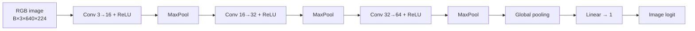
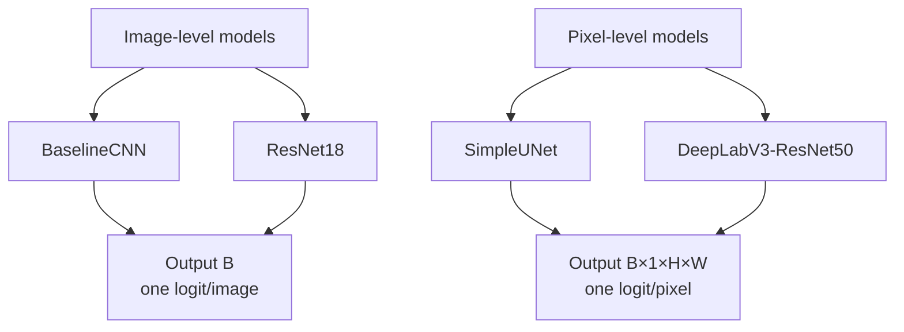
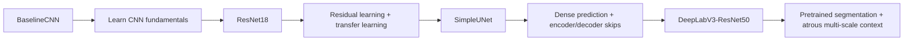

# Architecture atlas

This is the visual map of the neural-network architectures studied and used in the project.

The detailed notes explain each concept; this page answers at a glance:

- what the architecture is;
- what task it performs;
- what its main modules are;
- what tensor it produces;
- how it relates to the previous model.

When a standard architecture already has a good public diagram, this atlas prefers that sourced figure over redrawing it in Mermaid. Mermaid is kept mainly for project-specific flows that do not have a canonical external figure.

## Architecture versus layer versus backbone

A **layer** is one operation such as `Conv2d`, `BatchNorm2d`, `ReLU`, `MaxPool2d` or `Linear`.

An **architecture** is the organization of many layers and connections into a complete model.

A **backbone** is the feature-extraction subnetwork inside a larger model.

Detailed notes:

- [Backbones](topics/backbones.md)
- [ResNet family](topics/resnet-family.md)

---

# 1. BaselineCNN — scratch image classifier

## Goal

Binary image-level classification:

> Does this image contain a defect?

Output:

```text
[B]
```

one logit per image.

## Project-specific diagram

There is no canonical internet diagram for our custom baseline, so this one remains local to the project.



## Main lesson

A deliberately small CNN trained from random initialization. It made convolution, pooling, global pooling, logits, BCE and the training loop understandable before transfer learning.

Implementation:

`src/industrial_vision/models/baseline_cnn.py`

---

# 2. ResNet18 — pretrained residual classifier

## Goal

Image-level classification using a pretrained visual backbone.


*Source: [Wikimedia Commons — ResNet18 architecture](https://commons.wikimedia.org/wiki/File:Resnet-18_architecture_(rotated).svg), CC BY-SA 4.0, originally from Dive into Deep Learning.*

The project replaces the original 1000-class ImageNet classifier with a binary classifier.

## Residual block


*Source: [Wikimedia Commons — ResBlock](https://commons.wikimedia.org/wiki/File:ResBlock.png), CC BY-SA 4.0.*

The defining operation is:

```math
H(x)=F(x)+x
```

ResNet18 uses `BasicBlock` residual units and has about **11.69M parameters** in its standard ImageNet classifier form.

Project use:

- EXP-008: pretrained backbone frozen;
- EXP-009: `layer4` partially fine-tuned.

Implementation:

`src/industrial_vision/models/resnet18_classifier.py`

For the complete canonical family (`18/34/50/101/152`), block types, stage repeats, parameters and feature-map dimensions, see [ResNet family](topics/resnet-family.md).

---

# 3. Canonical ResNet family


*Source: [Wikimedia Commons — ResNetTypes](https://commons.wikimedia.org/wiki/File:ResNetTypes.png), CC BY-SA 4.0; based on the original ResNet paper.*

| Model | Block | Stage repeats | Standard classifier params |
|---|---|---|---:|
| ResNet18 | BasicBlock | `[2,2,2,2]` | 11,689,512 |
| ResNet34 | BasicBlock | `[3,4,6,3]` | 21,797,672 |
| ResNet50 | Bottleneck | `[3,4,6,3]` | 25,557,032 |
| ResNet101 | Bottleneck | `[3,4,23,3]` | 44,549,160 |
| ResNet152 | Bottleneck | `[3,8,36,3]` | 60,192,808 |

The project directly uses ResNet18 for classification and ResNet50 as the backbone inside DeepLabV3.

---

# 4. SimpleUNet — scratch semantic segmentation

## Goal

Pixel-level defect localization.

Output:

```text
[B,1,H,W]
```

one defect logit per pixel.

## Reference U-Net architecture


*Source: [Wikimedia Commons — U-Net architecture example](https://commons.wikimedia.org/wiki/File:Example_architecture_of_U-Net_for_producing_k_256-by-256_image_masks_for_a_256-by-256_RGB_image.png), CC BY-SA 4.0.*

Our `SimpleUNet` is intentionally smaller than the canonical U-Net, but it keeps the same structural idea: encoder, bottleneck, decoder and encoder-to-decoder skip connections.

## Structural idea

The encoder builds context by reducing spatial resolution. The decoder reconstructs a dense output. U-Net skip connections copy high-resolution encoder features into the decoder to recover localization detail.

Implementation:

`src/industrial_vision/models/simple_unet.py`

This is the M4 segmentation baseline used in EXP-010 through EXP-013.

---

# 5. DeepLabV3-ResNet50 — pretrained semantic segmentation

## Goal

The same binary pixel-level task as SimpleUNet, but using a modern pretrained model family.

## DeepLabV3-ResNet50 reference architecture


*Source: [ClarkArden/deeplabv3](https://github.com/ClarkArden/deeplabv3), a PyTorch DeepLabV3 implementation based on torchvision.*

Our wrapper uses the same high-level model family but adapts the final segmentation head to **one binary defect channel** and disables the auxiliary classifier.

Exact project pipeline:

```text
RGB image
   ↓
ImageNet normalization
   ↓
ResNet50 backbone
   ↓
deep feature map
   ↓
ASPP / DeepLabV3 classifier
   ↓
1 defect logit per pixel
   ↓
upsample to input size
```

## ASPP visual reference


*Source: [Applied Sciences 12(10), Figure 3](https://www.mdpi.com/2076-3417/12/10/5151), illustrating the standard ASPP parallel branches.*

Torchvision's `DeepLabHead` uses the same ASPP idea with default dilation rates `(12, 24, 36)`.

## What is new compared with SimpleUNet?

| SimpleUNet | DeepLabV3-ResNet50 |
|---|---|
| scratch training | pretrained initialization |
| small custom encoder | ResNet50 backbone |
| symmetric encoder-decoder | no symmetric U-Net decoder |
| encoder-decoder skip connections | ASPP multiscale context |
| ordinary convolutions | atrous/dilated convolutions in ASPP |
| no BatchNorm | BatchNorm throughout ResNet/ASPP |
| input `[0,1]` | ImageNet normalization |
| relatively light | much larger compute/VRAM cost |

Implementation:

`src/industrial_vision/models/deeplabv3.py`

Training:

`scripts/train_deeplabv3.py`

Detailed notes:

- [`../segmentation/topics/deeplabv3-resnet50.md`](../segmentation/topics/deeplabv3-resnet50.md)
- [`../segmentation/topics/atrous-convolution.md`](../segmentation/topics/atrous-convolution.md)
- [`../segmentation/topics/aspp.md`](../segmentation/topics/aspp.md)

---

# Output contract across the project

This is project-specific, so Mermaid is useful here.



The important software-design choice is that both segmentation architectures expose the same output contract. Therefore the project can reuse:

- `BCEDiceLoss`;
- `train_one_epoch`;
- `evaluate`;
- segmentation metrics;
- threshold sweep;
- qualitative prediction tooling.

The model changes while the evaluation contract stays stable.

---

# Progression of architectural ideas

This progression is specific to this project, so it remains a local diagram.



This order is intentional: each step introduces a limited number of new ideas while reusing the training/evaluation knowledge learned earlier.
