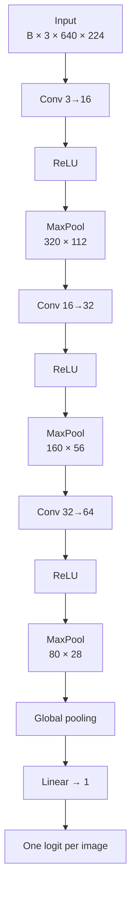
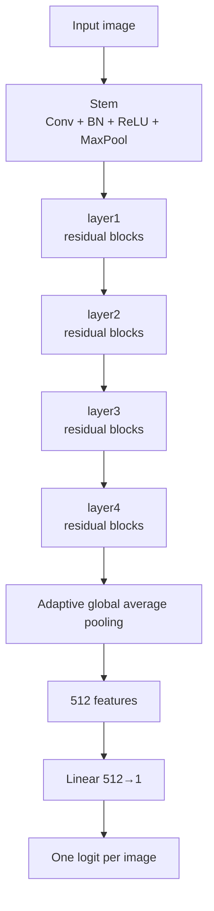
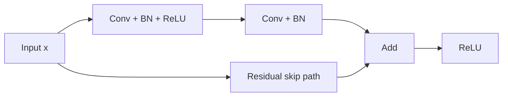
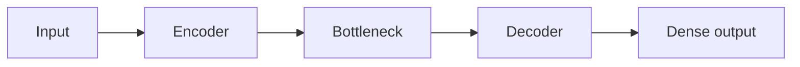
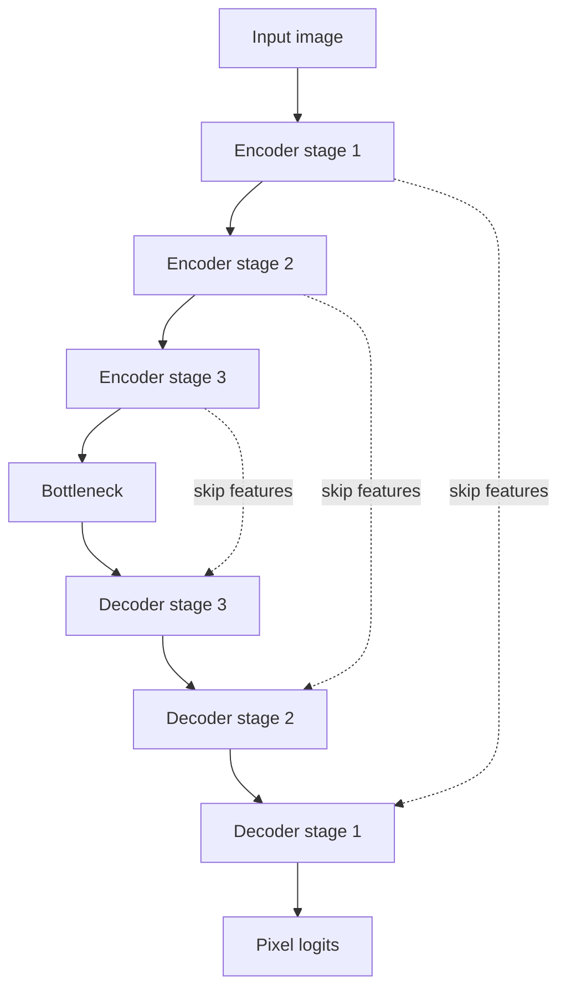
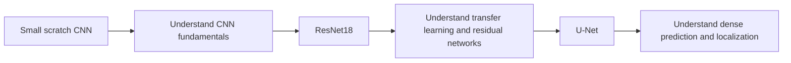

# Architecture atlas

This note is the visual map of the neural-network architectures studied in the project.

Its purpose is not to duplicate every detailed topic note. It gives one place to answer:

- What kind of model is this?
- What are its main parts?
- What does each part do?
- What output does it produce?
- Where is the detailed explanation?

## Architecture versus layer

A **layer** is one operation or parameterized transformation, such as `Conv2d`, `Linear`, `BatchNorm2d`, `ReLU` or `MaxPool2d`.

An **architecture** is the larger organization of many layers and connections into a complete model.

Examples in this project:

- `BaselineCNN` is a small classification architecture built from convolution, activation, pooling and a linear classifier;
- ResNet18 is a deeper classification architecture built around residual blocks;
- U-Net is an encoder-decoder segmentation architecture built around encoder-to-decoder skip connections.

A training regime such as **frozen ResNet18** or **partially fine-tuned ResNet18** changes which parameters are trained, but it does not create a different underlying ResNet18 architecture.

---

## 1. BaselineCNN — scratch image classifier

### Purpose

Binary image-level classification:

> Does this complete image contain a defect?

Output:

```text
[B]
```

One logit per image.

### Project implementation

`src/industrial_vision/models/baseline_cnn.py`

### Main architecture



### Parts

**Convolutions**

Learn feature maps from local image patterns.

**ReLU**

Introduces non-linearity.

**MaxPool**

Reduces spatial resolution while keeping channel count unchanged.

**Global pooling**

Collapses the final spatial grid into one feature vector for the whole image.

The project tested:

- global average pooling, GAP;
- global max pooling, GMP;
- concatenated GAP + GMP.

**Linear classifier**

Converts the final feature vector into one binary-classification logit.

### Main lesson

This model is deliberately small and trained from random initialization so every part of the classification pipeline can be understood before transfer learning.

Detailed notes:

- [`../cnn/README.md`](../cnn/README.md)
- [`../cnn/topics/convolution.md`](../cnn/topics/convolution.md)
- [`../cnn/topics/pooling.md`](../cnn/topics/pooling.md)
- [`../cnn/topics/classifier-and-loss.md`](../cnn/topics/classifier-and-loss.md)

---

## 2. ResNet18 — residual image classifier

### Purpose in this project

Binary image-level classification using a pretrained visual backbone.

Output after adapting the classifier:

```text
[B]
```

One logit per image.

### Project implementation

`src/industrial_vision/models/resnet18_classifier.py`

### High-level architecture



For the project input size, the approximate feature progression is:

```text
[B, 3,   640,224]
      ↓
[B, 64,  160, 56]
      ↓
[B,128,   80, 28]
      ↓
[B,256,   40, 14]
      ↓
[B,512,   20,  7]
      ↓ global average pooling
[B,512]
      ↓ classifier
[B]
```

### Residual block

The defining ResNet idea is a shortcut around a learned transformation:



Conceptually:

```math
H(x)=F(x)+x
```

The convolutional branch learns a residual correction `F(x)` while the skip gives the representation a direct path through the block.

### Frozen versus fine-tuned ResNet18

These are **training regimes**, not different architectures.

Frozen:

```text
backbone weights -> fixed
new classifier   -> trainable
```

Partial fine-tuning used in EXP-009:

```text
conv1/layer1/layer2/layer3 -> frozen
layer4                     -> trainable
classifier                 -> trainable
```

### Main lesson

Pretrained features were not sufficiently aligned with the industrial domain when completely frozen. Partial fine-tuning of `layer4` adapted the deeper representation and strongly improved the precision-recall trade-off.

Detailed notes:

- [`../transfer-learning/README.md`](../transfer-learning/README.md)
- [`../transfer-learning/topics/resnet-and-residual-blocks.md`](../transfer-learning/topics/resnet-and-residual-blocks.md)
- [`../transfer-learning/topics/pretraining-and-freezing.md`](../transfer-learning/topics/pretraining-and-freezing.md)
- [`../transfer-learning/topics/fine-tuning.md`](../transfer-learning/topics/fine-tuning.md)

---

## 3. Encoder-decoder — general architecture pattern

Encoder-decoder is a **general pattern**, not one exact network definition.

The encoder progressively transforms the input into lower-resolution, more contextual features.

The decoder transforms that deep representation back into a high-resolution output.



Many segmentation architectures are encoder-decoder models.

U-Net is one specific and famous example.

---

## 4. U-Net — semantic-segmentation architecture

### Purpose

Dense pixel-level prediction:

> Which pixels belong to the defect?

Binary-segmentation output:

```text
[B, 1, H, W]
```

One defect logit at every spatial position.

### Project status

U-Net is the M4 architecture currently being studied before implementation.

### Main architecture



### Parts

**Encoder**

A subnetwork made of convolution/downsampling blocks. It learns increasingly contextual features while reducing spatial resolution.

**Bottleneck**

The deepest spatially compressed representation between encoder and decoder.

**Decoder**

A subnetwork that increases spatial resolution again so a full-resolution prediction can be produced.

**U-Net skip connections**

Earlier encoder feature maps are copied to decoder stages with matching spatial resolution, typically by concatenation.

Their main role is to reintroduce fine localization information that would be difficult to reconstruct from the bottleneck alone.

**Final pixel classifier**

A common binary-segmentation final layer is:

```python
nn.Conv2d(C, 1, kernel_size=1)
```

It converts the `C` decoder feature channels at every spatial position into one defect logit.

### ResNet skip versus U-Net skip

They share the general idea of bypassing intermediate layers, but their purpose and combination are different.

| Architecture | Typical combination | Main purpose |
| --- | --- | --- |
| ResNet | addition | optimization and residual information flow |
| U-Net | concatenation | restore spatial/localization detail |

Detailed notes:

- [`../segmentation/README.md`](../segmentation/README.md)
- [`../segmentation/topics/encoder-decoder-and-unet.md`](../segmentation/topics/encoder-decoder-and-unet.md)
- [`../segmentation/topics/pixel-logits.md`](../segmentation/topics/pixel-logits.md)

---

## Comparison at a glance

| Architecture | Main task here | Output | Core structural idea |
| --- | --- | --- | --- |
| BaselineCNN | classification | `[B]` | simple Conv/ReLU/Pool feature extractor + global pooling |
| ResNet18 | classification | `[B]` | residual blocks and pretrained backbone |
| Encoder-decoder | dense prediction pattern | spatial output | compress context, then recover resolution |
| U-Net | segmentation | `[B,1,H,W]` | encoder-decoder plus matching-resolution skip connections |

## Why the project studies them in this order



The order is deliberate: each architecture reuses concepts already learned and introduces only a small number of new structural ideas.
