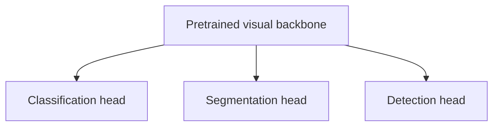

# Backbones in computer vision

## What is a backbone?

A **backbone** is the part of a neural network whose main job is to transform the raw image into progressively more useful feature maps.

A useful mental model is:


The backbone answers roughly:

> What visual structures are present?

The task-specific head answers roughly:

> How do I convert those features into the output required by this task?

## Backbone versus complete model

A backbone is usually **not the whole network**.

For image classification with ResNet18:


For our current DeepLabV3 model:


In DeepLabV3-ResNet50, **ResNet50 is the backbone**. DeepLabV3 is the complete semantic-segmentation architecture built around that backbone and its multiscale context module.

## Why call it a backbone?

The same feature extractor can often support several tasks by changing the task-specific components on top.

Conceptually:



The backbone provides a reusable visual representation.

## What does a backbone learn?

Earlier stages usually represent more generic patterns:

- edges;
- local contrast;
- simple textures;
- orientations.

Deeper stages combine them into more abstract patterns:

- larger texture structures;
- shapes;
- object or region-level visual patterns;
- task-relevant combinations of features.

This is an approximate hierarchy, not a strict rule saying that one exact layer always detects one exact object.

## Backbone, neck and head

Many modern computer-vision systems can be described as:

```text
image
  ↓
backbone
  ↓
feature maps
  ↓
neck / context module
  ↓
head
  ↓
prediction
```

Terminology is not perfectly universal across papers and libraries.

In our DeepLabV3 mental model:

- **backbone:** ResNet50;
- **context / segmentation module:** ASPP plus the DeepLab classifier layers;
- **output head:** final convolution producing one defect logit per pixel.

## Frozen versus trainable backbone

A backbone can be reused in different ways.

### Frozen feature extractor

```text
pretrained backbone -> fixed
new head            -> trainable
```

The target dataset uses the existing representation without changing it.

This is transfer learning **without** backbone fine-tuning.

### Fine-tuned backbone

```text
pretrained backbone -> trainable partly or fully
head                -> trainable
```

Now gradients from the target loss modify the pretrained representation.

## Project examples

### EXP-008 — frozen ResNet18

ResNet18 was used as a pretrained feature extractor while the new defect classifier was trained.

### EXP-009 — partially fine-tuned ResNet18

`layer4` and the classifier were trainable while earlier stages stayed frozen.

### EXP-014 — DeepLabV3-ResNet50

ResNet50 is the segmentation backbone and the complete model is fine-tuned on KSDD2.

## Common mistakes

- Calling the entire model the backbone when only one subnetwork is the feature extractor.
- Assuming a backbone must be frozen. A backbone can be frozen or fine-tuned.
- Assuming a pretrained backbone is automatically optimal for the target domain.
- Confusing backbone parameters with the task-specific classifier parameters.

## Interview explanation

> A backbone is the feature-extraction part of a computer-vision model. It converts the input image into hierarchical feature maps that a task-specific head can use. In my project I first used ResNet18 as a classification backbone, and later ResNet50 as the backbone inside DeepLabV3 for semantic segmentation.

## Questions to be able to answer

1. What is the difference between a backbone and a head?
2. Is a backbone always pretrained?
3. Is a backbone always frozen?
4. Which backbone does our current DeepLabV3 model use?
5. Why can the same backbone be reused for different visual tasks?
