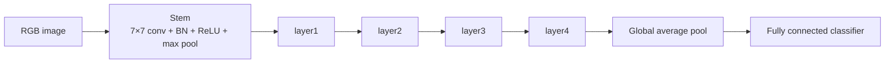
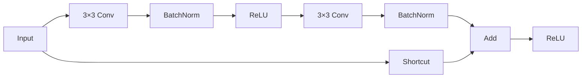
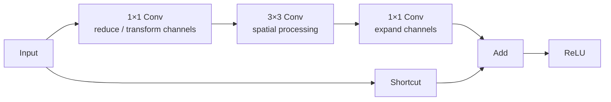
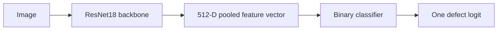
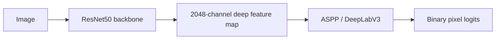
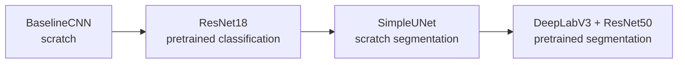

# ResNet family — ResNet18, 34, 50, 101 and 152

## Core idea

ResNet means **Residual Network**.

The key idea is that a block does not need to learn the complete transformation from scratch. It learns a residual correction `F(x)` and adds the original input through a shortcut:

```math
H(x)=F(x)+x
```

```mermaid
flowchart LR
    X[Input x] --> C1[Convolutional path F(x)]
    X --> S[Shortcut / identity path]
    C1 --> A[Add]
    S --> A
    A --> O[Output H(x)]
```

The shortcut gives information and gradients a direct route through the network, making very deep CNNs easier to optimize.

---

## Canonical ResNet family

The canonical torchvision models are:

| Model | Residual block | Stage repeats `[layer1, layer2, layer3, layer4]` | Full ImageNet classifier parameters |
|---|---|---|---:|
| ResNet18 | BasicBlock | `[2, 2, 2, 2]` | 11,689,512 |
| ResNet34 | BasicBlock | `[3, 4, 6, 3]` | 21,797,672 |
| ResNet50 | Bottleneck | `[3, 4, 6, 3]` | 25,557,032 |
| ResNet101 | Bottleneck | `[3, 4, 23, 3]` | 44,549,160 |
| ResNet152 | Bottleneck | `[3, 8, 36, 3]` | 60,192,808 |

These parameter counts refer to the standard torchvision ImageNet classification models including their original 1000-class fully connected layer. When ResNet is used as a backbone or its classifier is replaced, the exact total changes.

The number in the model name is related to the conventional count of weighted layers in the original architecture, not the number of residual blocks.

---

## Common high-level architecture

All canonical ResNets follow the same broad pattern:



What changes between ResNet18/34/50/101/152 is mainly:

- the type of residual block;
- the number of blocks in each stage;
- the channel expansion inside bottleneck models.

---

## BasicBlock — ResNet18 and ResNet34

A BasicBlock uses two `3×3` convolutions.



For these models the stage output widths are approximately:

```text
layer1 -> 64 channels
layer2 -> 128 channels
layer3 -> 256 channels
layer4 -> 512 channels
```

ResNet18 uses fewer blocks than ResNet34, so it is lighter and faster.

---

## Bottleneck block — ResNet50, ResNet101 and ResNet152

Deeper ResNets use a three-convolution bottleneck block:



The `1×1 -> 3×3 -> 1×1` design lets the expensive spatial convolution operate in a narrower intermediate representation.

For ResNet50/101/152 the stage output widths are:

```text
layer1 -> 256 channels
layer2 -> 512 channels
layer3 -> 1024 channels
layer4 -> 2048 channels
```

The main difference among 50, 101 and 152 is how many bottleneck blocks are repeated.

---

## ResNet18 versus ResNet50

This project has used both.

### ResNet18

Used in M3 for image-level defect classification.



### ResNet50

Used as the backbone inside DeepLabV3 in M5.



ResNet50 is not simply “ResNet18 with more layers”. It also changes from BasicBlocks to Bottleneck blocks and its deepest feature representation is much wider.

---

## Feature-map shapes for our `640 × 224` images

The exact shape depends on the model configuration, but a standard ResNet progression with our project input is approximately:

```text
input             [B,   3, 640, 224]
7×7 conv stride 2 [B,  64, 320, 112]
max pool stride 2 [B,  64, 160,  56]
layer1            [B,   C1,160,  56]
layer2            [B,   C2, 80,  28]
layer3            [B,   C3, 40,  14]
layer4            [B,   C4, 20,   7]
```

For ResNet18/34:

```text
C1=64, C2=128, C3=256, C4=512
```

For ResNet50/101/152:

```text
C1=256, C2=512, C3=1024, C4=2048
```

---

## “Neurons” in a CNN: better to think in activations

For dense neural networks it is common to talk about a fixed number of neurons in a layer.

For CNNs, the more useful language is:

- **channels**: number of learned feature types;
- **height × width**: number of spatial positions;
- **activations**: `channels × height × width` values produced for one sample;
- **parameters**: trainable weights and biases stored in the layer.

These are not the same thing.

For example, a ResNet50 `layer4` output for one project image is approximately:

```text
2048 × 20 × 7 = 286,720 activations
```

but those 286,720 activations are not 286,720 independent learned parameters. The convolution kernels are shared across spatial positions.

This weight sharing is one of the defining properties of CNNs.

---

## Why deeper does not automatically mean better

Going from ResNet18 to ResNet50/101/152 increases capacity and computational cost.

Potential advantages:

- more expressive representations;
- larger effective receptive field;
- stronger pretrained features for some tasks.

Potential disadvantages:

- slower training and inference;
- higher VRAM use;
- greater overfitting risk on small datasets;
- no guarantee that source-domain features match an industrial domain.

Architecture size is therefore an experimental choice, not a quality ranking.

---

## Parameters versus trainable parameters

A model can contain 25 million parameters while only a small subset is trainable.

Example:

```text
ResNet50 total parameters
        !=
parameters updated by optimizer
```

If the backbone is frozen, its parameters still exist in memory but do not receive optimizer updates.

If the backbone is fine-tuned, some or all of them become trainable.

---

## Project map



The project deliberately moved from a small understandable network toward deeper pretrained architectures only after the underlying training and segmentation concepts were clear.

---

## Interview questions

1. What problem do residual connections solve?
2. What is the difference between ResNet18 and ResNet50 besides depth?
3. What is a BasicBlock?
4. What is a Bottleneck block?
5. Why does ResNet50 end with 2048-channel features while ResNet18 ends with 512?
6. What is the difference between activations and parameters?
7. Why can a deeper ResNet still perform worse on a specialized target dataset?
8. Which ResNets have we used directly in this project and for what tasks?
