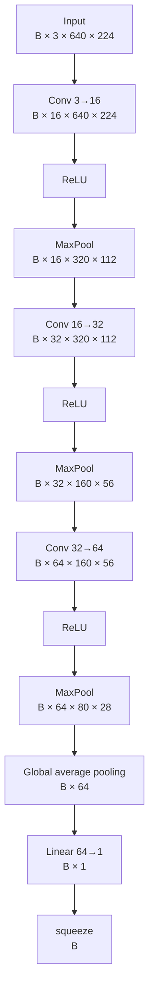

# CNN basics — our baseline classifier

This note explains the concepts used in `BaselineCNN` and connects each idea to the actual tensors that move through the model.

The goal is not only to know definitions, but to be able to follow one image through the network and explain what each layer does, why it is there, and how the tensor changes.

## What is a CNN?

A Convolutional Neural Network (CNN) is a neural network that uses convolutional layers to learn spatial patterns from images.

A convolution applies small learnable weights locally across an image. Those weights are reused at every spatial position, producing feature maps that describe where learned patterns are strongly or weakly present.

In this project, the M2 baseline performs **binary image classification**:

- `0` = clean image;
- `1` = defective image.

Pixel-level localization comes later in the segmentation milestones.

---

## Tensors

A tensor is a multidimensional array of numbers. In PyTorch, images, weights, activations, labels, logits and gradients are all represented as tensors.

Examples:

```text
scalar:  7
vector:  [1, 4, 8]
matrix:  [[1, 2],
          [3, 4]]
image tensor: [C, H, W]
batch tensor: [B, C, H, W]
```

Our image tensor has shape:

```text
[C, H, W] = [3, 640, 224]
```

A batch of four images has:

```text
[B, C, H, W] = [4, 3, 640, 224]
```

`B` is batch size, `C` is channels, and `H × W` is the **spatial size**.

---

## Convolution, patch, kernel and filter

Our first layer is:

```python
nn.Conv2d(3, 16, kernel_size=3, padding=1)
```

It means:

- 3 input channels: RGB;
- 16 output channels;
- kernel spatial size: `3 × 3`;
- default stride: `1`;
- padding: `1` pixel around the image.

### Patch vs kernel

These are different things.

```text
PATCH
= values from the image currently being read

KERNEL
= learnable weights applied to that patch
```

For one channel:

```text
image patch             kernel weights

2  5  1                 0.2 -0.1  0.3
4  7  3        ×        0.5  0.1 -0.2
1  0  6                -0.3  0.4  0.2

                 ↓
       weighted sum + bias
                 ↓
          one output value
```

Then the same kernel weights are applied at the next spatial position.

### Stride

Stride is the spatial step used when moving the kernel.

```text
stride = 1  → move one pixel at a time
stride = 2  → move two pixels at a time
```

A larger stride samples fewer positions and therefore usually reduces the output spatial size.

### Filter vs kernel

Terminology is not perfectly consistent across books and libraries, but this mental model is useful:

```text
kernel
= k × k spatial weight matrix for one input channel

filter
= complete set of kernels spanning all input channels
  and producing one output feature map
```

For the first RGB convolution, one complete filter has shape:

```text
[3, 3, 3]
 ↑  ↑  ↑
 C  H  W
```

It contains one `3×3` set of weights for R, one for G and one for B.

### One filter produces one feature map

Conceptually:

```text
RGB image
   │
   ├── filter 1  → feature map 1
   ├── filter 2  → feature map 2
   ├── ...
   └── filter 16 → feature map 16
```

Each filter uses the same learned weights at every spatial position. The collection of output values across the image forms one feature map.

Our first layer therefore transforms:

```text
[B, 3, 640, 224]
        ↓
[B,16, 640, 224]
```

The interactive convolution demo is at:

`docs/learning/visuals/convolution-kernel-demo.html`

---

## Weight tensor

PyTorch stores all filters of one convolution together in a weight tensor.

For:

```python
nn.Conv2d(3, 16, kernel_size=3)
```

the weight tensor has shape:

```text
[16, 3, 3, 3]
 ↑   ↑  ↑  ↑
 |   |  |  └─ kernel width
 |   |  └──── kernel height
 |   └─────── input channels
 └─────────── output filters / channels
```

So:

```text
one filter       = [3, 3, 3]
all 16 filters   = [16, 3, 3, 3]
```

The weights are initialized before training and then learned by optimization.

The **weight tensor** contains model parameters. The **activation tensor** contains the values produced when an image passes through the model. They are not the same thing.

---

## Channels and spatial size are different axes

This distinction is essential.

For a tensor:

```text
[B, C, H, W]
```

we have:

```text
C     = number of channels / feature maps
H × W = spatial size / spatial resolution
```

The kernel size is a third, separate concept.

For example:

```text
feature map spatial size = 640 × 224
kernel size              = 3 × 3
channels                 = 16
```

So **spatial size does not mean kernel size**.

### Why does the convolution keep `640 × 224`?

Our convolution uses:

```text
kernel = 3×3
stride = 1
padding = 1
```

The padding compensates for the pixels that would otherwise be lost at the borders, so:

```text
640 × 224
   ↓ Conv
640 × 224
```

### Why do we later say spatial resolution is reduced?

Because the reduction in our baseline comes mainly from **MaxPool**, not from changing the kernel size.

The kernel remains `3×3` in all three convolutions, while the feature maps become smaller:

```text
640 × 224
    ↓ MaxPool
320 × 112
    ↓ MaxPool
160 × 56
    ↓ MaxPool
80 × 28
```

So these are independent:

```text
kernel size:          3×3 → 3×3 → 3×3
spatial resolution: 640×224 → 320×112 → 160×56 → 80×28
channels:             3 → 16 → 32 → 64
```

---

## Why do channels increase?

The number of output channels is an architectural choice.

We selected:

```text
3 → 16 → 32 → 64
```

There is nothing mathematically special about 16. We could have chosen 8, 32 or another value.

More channels give the network capacity to learn more different representations, but also increase parameters, memory and computation.

A common CNN design pattern is:

```text
spatial resolution decreases
while
number of feature maps increases
```

Mental model:

```text
less detailed spatial grid
+
more learned representations at each stage
```

---

## Feature maps and interpretability

A filter is learned because its behavior helps reduce the training objective. We do not manually assign meanings such as:

```text
filter 7 = scratch detector
filter 12 = defective-piece detector
```

Early filters often respond to relatively simple patterns such as edges, contrast, color or texture. Deeper representations are usually harder to describe in simple human terms.

We can inspect filters and feature maps and ask which inputs activate them strongly, but there is usually no guaranteed one-filter/one-human-concept mapping.

A concept such as `defect` is generally represented by many activations distributed across filters and layers.

---

## ReLU and non-linearity

After every convolution we use:

```python
nn.ReLU()
```

ReLU is:

```text
ReLU(x) = max(0, x)
```

So:

```text
before ReLU     after ReLU

-2.0               0.0
-0.3               0.0
 0.0               0.0
 1.5               1.5
 4.2               4.2
```

ReLU changes values, not tensor shape:

```text
[B, C, H, W] → [B, C, H, W]
```

### Why do we need a non-linear activation?

A convolution or linear layer is an affine transformation. If we compose only affine transformations, the whole stack can still be represented as one affine transformation.

Conceptually:

```text
affine → affine → affine

can collapse to

one affine transformation
```

A non-linear activation prevents that collapse and gives a deep network much greater expressive power.

### But ReLU leaves positive values unchanged. Is it always introducing non-linearity?

This is an important nuance.

ReLU is a **non-linear function globally**, because its rule changes at zero:

```text
x < 0  → 0
x ≥ 0  → x
```

However, inside a region where all relevant pre-activations are positive, ReLU behaves exactly like the identity function:

```text
ReLU(x) = x
```

So for that particular input region, a sequence of affine layers plus ReLUs may behave locally like an affine function.

That does **not** make the network globally linear. Different inputs can cross different ReLU boundaries, activating different subsets of units. A ReLU network is therefore **piecewise linear**: linear/affine inside each region, but with many different regions joined together into a globally non-linear function.

This is the key distinction:

```text
ReLU is not required to modify every value
for the network to be non-linear globally.
```

---

## Why ReLU instead of another activation?

There is no universal best activation function. The choice depends on optimization behavior, architecture, computational cost and empirical performance.

For hidden layers, useful criteria include:

- does it introduce non-linearity?
- does it preserve useful gradients during training?
- is it computationally cheap?
- is it stable in deep networks?
- does it work well empirically for this architecture?

### ReLU

```text
ReLU(x) = max(0, x)
```

Advantages:

- simple;
- very cheap to compute;
- positive side has gradient 1;
- historically strong default for CNNs;
- easy to understand for a baseline.

Main drawback:

- for negative inputs the gradient is zero; a unit can become inactive for many inputs (`dying ReLU`).

### LeakyReLU

Keeps a small non-zero slope for negative values.

Useful when zero gradients on the negative side are a concern.

### GELU

Smooth activation widely used in Transformers and modern architectures.

It is more complex than necessary for our first CNN baseline.

### SiLU / Swish

Smooth non-linearity used successfully in several modern CNN architectures.

Again, it can work very well, but ReLU keeps our baseline simpler.

### Sigmoid

Maps values to `(0,1)` and is useful for our final binary probability interpretation, but is usually not the first choice for hidden CNN layers because it saturates for large positive or negative values and can produce very small gradients.

### Why we chose ReLU here

Not because it is always the best activation, but because it is:

```text
simple + standard + computationally cheap + adequate for our baseline
```

Later, changing activation function could be treated as an experiment if we have a concrete reason to test it.

---

## Max pooling

After each ReLU we use:

```python
nn.MaxPool2d(2)
```

A `2×2` max-pooling operation takes a local `2×2` region and keeps the largest activation.

```text
1  5
2  3

→ 5
```

With its default stride of 2:

```text
640 × 224 → 320 × 112
320 × 112 → 160 × 56
160 × 56  → 80 × 28
```

MaxPool changes `H` and `W`, but not the number of channels.

Its advantages here are lower computation and a compact representation. Its cost is loss of spatial detail, which becomes much more important later for segmentation.

---

## Full shape flow through our CNN



| Stage | Shape |
|---|---|
| Input | `[B, 3, 640, 224]` |
| Conv 3→16 | `[B, 16, 640, 224]` |
| ReLU | `[B, 16, 640, 224]` |
| MaxPool | `[B, 16, 320, 112]` |
| Conv 16→32 | `[B, 32, 320, 112]` |
| ReLU | `[B, 32, 320, 112]` |
| MaxPool | `[B, 32, 160, 56]` |
| Conv 32→64 | `[B, 64, 160, 56]` |
| ReLU | `[B, 64, 160, 56]` |
| MaxPool | `[B, 64, 80, 28]` |
| Global average pooling | `[B, 64]` |
| Linear 64→1 | `[B, 1]` |
| `squeeze(1)` | `[B]` |

---

## Global average pooling

After the last MaxPool:

```text
[B, 64, 80, 28]
```

we use:

```python
features.mean(dim=(2, 3))
```

Each complete `80×28` feature map becomes one average value:

```text
[B, 64, 80, 28]
        ↓
[B, 64]
```

This is different from MaxPool:

- MaxPool performs a local maximum reduction repeatedly;
- global average pooling averages the entire remaining spatial map.

It keeps the classifier small compared with flattening all `64×80×28` values.

---

## Output layer, logit and binary classification

The classifier is:

```python
nn.Linear(64, 1)
```

It produces one raw score per image: a **logit**.

```text
[B,64] → [B,1] → squeeze → [B]
```

A logit can take any real value. It is not yet a probability.

Sigmoid converts it to `P(defect)`:

```text
large negative logit → probability near 0
logit = 0            → probability 0.5
large positive logit → probability near 1
```

One output is sufficient because this is binary classification:

```text
P(clean) = 1 - P(defect)
```

---

## BCEWithLogitsLoss

During training we will use:

```python
nn.BCEWithLogitsLoss()
```

It receives raw logits and true binary labels. It combines the sigmoid-related computation and binary cross-entropy in a numerically stable formulation.

Therefore we should not apply sigmoid before passing predictions to this loss.

We will study loss, gradients, backpropagation and optimization separately before implementing the complete training loop.

---

## Parameter count

The current model has 23,649 trainable parameters.

```text
Conv 3 → 16:      448
Conv 16 → 32:   4,640
Conv 32 → 64:  18,496
Linear 64 → 1:     65
-----------------------
Total:          23,649
```

For the first layer specifically:

```text
16 filters × 3 channels × 3 × 3 = 432 weights
16 biases                            16
                                      ───
                                      448
```

---

## Why do we need this baseline?

The goal is not to build the best possible defect classifier immediately.

This architecture is deliberately small enough to understand end to end while learning:

- convolution;
- tensors;
- patches, kernels and filters;
- feature maps;
- channels and spatial resolution;
- stride and padding;
- activation functions;
- pooling;
- logits and binary classification;
- later: loss, backpropagation and optimization.

---

## Alternatives and trade-offs

### No pooling

Preserves more spatial information, but computation and memory remain higher.

### Strided convolution instead of MaxPool

Can learn the downsampling operation, but adds complexity to our first baseline.

### Flatten instead of global average pooling

Would create `64×80×28 = 143,360` values per image before the classifier, making the final dense part much larger.

### Different activation functions

ReLU, LeakyReLU, GELU and SiLU all have useful properties. ReLU is our baseline choice because simplicity and explainability matter more than testing every possible activation at M2.

---

## Common mistakes

- Confusing spatial size with kernel size.
- Thinking `3×3` means the feature map is `3×3`.
- Thinking the patch is the kernel. The patch contains image values; the kernel contains weights.
- Assuming filters are manually chosen. Their weights are learned.
- Thinking stride changes the filter weights. It only changes how the filter moves spatially.
- Assuming ReLU must change every activation to make the network non-linear.
- Assuming ReLU changes tensor shape.
- Assuming MaxPool changes channel count.
- Confusing MaxPool with global average pooling.
- Treating a logit as a probability.
- Applying sigmoid before `BCEWithLogitsLoss`.
- Assuming one learned filter necessarily corresponds to one human-readable concept.

---

## Interview explanation

> The baseline is a small three-block CNN for binary defect classification. Each block uses a 3×3 convolution, ReLU and 2×2 max pooling. The 3×3 kernel size describes the local receptive operation, while the spatial dimensions describe the height and width of the feature maps. Padding keeps the convolutional spatial size unchanged, and max pooling reduces it from 640×224 to 80×28. Channels increase from 3 to 16, 32 and 64 to provide capacity for progressively richer learned representations. ReLU makes the network globally non-linear; more precisely, a ReLU network is piecewise linear because ReLU behaves as identity on positive inputs and zero on negative inputs. Global average pooling converts the final feature maps into 64 values and a linear layer produces one binary-classification logit.

---

## Questions I should be able to answer

1. What is the difference between a patch, a kernel and a filter?
2. What does `Conv2d(3, 16, kernel_size=3, padding=1)` mean?
3. What does the convolution weight tensor `[16, 3, 3, 3]` represent?
4. Why does one filter produce one feature map?
5. What is stride?
6. What is the difference between channel count, spatial size and kernel size?
7. Why does our `3×3` convolution preserve `640×224`?
8. What operation actually reduces `640×224` to `320×112` in our baseline?
9. Why do channels increase while spatial dimensions decrease?
10. Why is ReLU non-linear even though positive values pass through unchanged?
11. In what sense is a ReLU network piecewise linear?
12. What criteria matter when choosing an activation function?
13. Why did we choose ReLU for this baseline?
14. What does MaxPool change in `[B,C,H,W]`?
15. What is the difference between MaxPool and global average pooling?
16. What is a logit?
17. Why does our binary classifier need only one output?
18. Why should sigmoid not be applied before `BCEWithLogitsLoss`?
19. Can we always assign a clear human meaning to each learned filter?

---

## Evidence

- Code: `src/industrial_vision/models/baseline_cnn.py`
- Test: `tests/test_baseline_cnn.py`
- Interactive convolution demo: `docs/learning/visuals/convolution-kernel-demo.html`
- Baseline implementation commit: `d2a540d`
