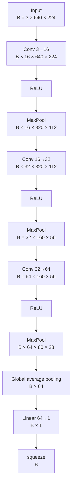

# CNN basics — our baseline classifier

These are **study notes**, not only a compact reference. They are meant to be useful if Santiago returns to the project months later and needs to reconstruct the reasoning behind the model.

The note therefore keeps:

- definitions;
- visual and mathematical intuition;
- the actual tensor shapes from this project;
- questions that caused confusion and the clarification that resolved them;
- trade-offs and common mistakes;
- interview-level summaries.

The model studied here is `BaselineCNN`, used in M2 for binary image classification:

- `0` = clean image;
- `1` = defective image.

Pixel-level localization comes later in the segmentation milestones.

---

## 1. What is a CNN?

A Convolutional Neural Network (CNN) is a neural network that uses convolutional layers to learn spatial patterns from images.

A convolution applies small learnable weights locally across an image. Those weights are reused at every spatial position, producing feature maps that describe where learned patterns are strongly or weakly present.

The word **convolutional** refers to this repeated local operation: a small learned filter is applied across the spatial positions of the input.

A useful high-level picture is:

```text
image
  ↓
convolution
  ↓
feature maps
  ↓
non-linearity
  ↓
spatial reduction
  ↓
richer feature maps
  ↓
classification
```

---

## 2. Tensors

A tensor is a multidimensional array of numbers. In PyTorch, images, weights, activations, labels, logits and gradients are all represented as tensors.

Examples:

```text
scalar:  7
vector:  [1, 4, 8]
matrix:  [[1, 2],
          [3, 4]]
image tensor: [C, H, W]
batch tensor: [B, C, H, W]
```

Our image tensor has shape:

```text
[C, H, W] = [3, 640, 224]
```

A batch of four images has:

```text
[B, C, H, W] = [4, 3, 640, 224]
```

where:

```text
B = batch size
C = channels
H = height
W = width
```

### Study clarification: what is a weight tensor?

A weight tensor is simply the tensor in which PyTorch stores the learnable parameters of a layer.

For a convolution, it contains all convolutional filters together. It is not a different concept from the filters; it is the data structure that stores their numbers.

---

## 3. Convolution, patch, kernel and filter

Our first layer is:

```python
nn.Conv2d(3, 16, kernel_size=3, padding=1)
```

It means:

- 3 input channels: RGB;
- 16 output channels;
- kernel spatial size: `3 × 3`;
- default stride: `1`;
- padding: `1` pixel around the image.

### 3.1 Patch vs kernel

These are different things.

```text
PATCH
= values from the input currently being read

KERNEL
= learnable weights applied to that patch
```

For one channel:

```text
image patch             kernel weights

2  5  1                 0.2 -0.1  0.3
4  7  3        ×        0.5  0.1 -0.2
1  0  6                -0.3  0.4  0.2

                 ↓
       weighted sum + bias
                 ↓
          one output value
```

The kernel weights stay the same while the patch changes as we move across the image.

The interactive demonstration is at:

`docs/learning/visuals/convolution-kernel-demo.html`

### 3.2 Stride

Stride is the spatial step used when moving the kernel.

```text
stride = 1  → move one pixel at a time
stride = 2  → move two pixels at a time
```

So Santiago's useful mental model is:

```text
stride ≈ spatial delta between consecutive kernel positions
```

A larger stride samples fewer positions and usually reduces output spatial resolution.

### 3.3 Filter vs kernel

Terminology is not perfectly consistent across books and libraries. For these notes, use this mental model:

```text
kernel
= k × k spatial weight matrix for one input channel

filter
= complete set of kernels spanning all input channels
  and producing one output feature map
```

For an RGB input, one complete filter in the first convolution has shape:

```text
[3, 3, 3]
 ↑  ↑  ↑
 C  H  W
```

It contains one `3×3` kernel for R, one for G and one for B.

### 3.4 One filter produces one feature map

Conceptually:

```text
RGB image
   │
   ├── filter 1  → feature map 1
   ├── filter 2  → feature map 2
   ├── ...
   └── filter 16 → feature map 16
```

Each filter is reused at every spatial position. Every position produces one number; the collection of those numbers forms the feature map.

Therefore:

```text
one learned filter
        ↓
one feature map
```

Our first convolution has 16 different filters, so it produces 16 feature maps.

### 3.5 Why 16 filters?

`16` is an architectural choice, not a value determined by RGB.

We could have chosen 8, 32 or another value.

More filters mean more representational capacity, but also:

- more parameters;
- more memory;
- more computation;
- potentially more overfitting.

For a first baseline, `16 → 32 → 64` is small, common and easy to reason about.

---

## 4. Convolution weight tensor

For:

```python
nn.Conv2d(3, 16, kernel_size=3)
```

PyTorch stores the convolution weights with shape:

```text
[16, 3, 3, 3]
 ↑   ↑  ↑  ↑
 |   |  |  └─ kernel width
 |   |  └──── kernel height
 |   └─────── input channels
 └─────────── output filters / channels
```

So:

```text
one filter       = [3, 3, 3]
all 16 filters   = [16, 3, 3, 3]
```

The weights are initialized before training and then learned through optimization.

Important distinction:

```text
weight tensor
= learnable parameters of the model

activation tensor
= values produced when data passes through the model
```

---

## 5. What is actually learned by a convolution?

The values inside the filters are trainable parameters.

At initialization they do not already mean “edge”, “scratch”, or “defect”. During training, the optimization process changes them so the network becomes better at the classification task.

Early convolutional layers often end up responding to relatively simple local patterns such as:

- edges;
- contrast changes;
- color combinations;
- local textures.

Deeper layers combine earlier representations and become harder to describe with one simple human label.

### Study clarification: can we know exactly what each filter extracts?

Usually not exactly.

We can visualize filters and feature maps and investigate which inputs activate them strongly, but there is no guaranteed mapping such as:

```text
filter 7 = scratch detector
filter 12 = defect detector
```

A high-level concept such as `defect` is normally represented by many activations distributed across filters and layers.

---

## 6. Channels, spatial size and kernel size are different things

For a tensor:

```text
[B, C, H, W]
```

we have:

```text
C     = number of channels / feature maps
H × W = spatial size / spatial resolution
```

The kernel size is separate.

Example:

```text
channels                 = 16
feature-map spatial size = 640 × 224
kernel size              = 3 × 3
```

So **spatial size does not mean kernel size**.

### 6.1 Why does our convolution preserve `640 × 224`?

Our convolution uses:

```text
kernel = 3×3
stride = 1
padding = 1
```

Padding compensates for what would otherwise be lost at the image border:

```text
640 × 224
   ↓ Conv
640 × 224
```

### 6.2 Why does spatial resolution later decrease if kernels remain `3×3`?

Because in this baseline the main spatial reduction comes from **MaxPool**, not from changing kernel size.

```text
kernel size:          3×3 → 3×3 → 3×3
spatial resolution: 640×224 → 320×112 → 160×56 → 80×28
channels:             3 → 16 → 32 → 64
```

These three quantities are independent axes/design choices.

---

## 7. Why do channels increase while spatial resolution decreases?

This is a common CNN design pattern:

```text
less detailed spatial grid
+
more learned representations
```

Our network does not literally trade pixels for channels in one operation. Two different operations are responsible:

```text
Conv
→ can increase number of feature maps

MaxPool
→ reduces spatial resolution
```

Our flow is:

```text
[3, 640, 224]
    ↓ Conv 3→16
[16, 640, 224]
    ↓ MaxPool
[16, 320, 112]
    ↓ Conv 16→32
[32, 320, 112]
    ↓ MaxPool
[32, 160, 56]
    ↓ Conv 32→64
[64, 160, 56]
    ↓ MaxPool
[64, 80, 28]
```

It is better to say that we lose **spatial detail/resolution**, not that we necessarily lose “quality”. A smaller spatial grid can be a better representation for classification even though it contains less precise location information.

For image classification, exact pixel position is often less important than whether useful patterns are present.

For segmentation, spatial detail becomes much more important because the model must also answer **where** the defect is.

---

## 8. ReLU and non-linearity

After every convolution we use:

```python
nn.ReLU()
```

ReLU is:

```text
ReLU(x) = max(0, x)
```

So:

```text
before ReLU     after ReLU

-2.0               0.0
-0.3               0.0
 0.0               0.0
 1.5               1.5
 4.2               4.2
```

### 8.1 When exactly is ReLU applied?

The convolution first produces numbers called **pre-activations**.

Example feature map after a convolution:

```text
-1.2   0.7   2.1
 0.3  -0.8   1.5
-2.4   3.0  -0.2
```

ReLU is applied element-by-element to every value:

```text
 0.0   0.7   2.1
 0.3   0.0   1.5
 0.0   3.0   0.0
```

The values after the activation function are called **activations**.

So the local flow is:

```text
patch + learned filter weights
          ↓
convolution
          ↓
pre-activation z
          ↓
ReLU(z)
          ↓
activation a
```

### 8.2 Why do we need a non-linear activation?

A convolution or linear layer is an affine transformation. If we compose only affine transformations, the whole stack can still be represented as one affine transformation.

```text
affine → affine → affine

can collapse to

one affine transformation
```

A non-linear activation prevents that global collapse and greatly increases the functions the network can represent.

### 8.3 But ReLU leaves positive values unchanged

Correct.

ReLU is globally non-linear because its rule changes at zero:

```text
x < 0  → 0
x ≥ 0  → x
```

But in a region where all relevant pre-activations are positive:

```text
ReLU(x) = x
```

So the network can behave locally like an affine function there.

This does not make the whole network linear. Different inputs cross different ReLU boundaries and activate different subsets of units.

A ReLU network is therefore **piecewise linear**: affine inside local regions, globally non-linear across regions.

### 8.4 Why keep positive values and zero negative values?

There is no mathematical law saying that negative values are “bad”. ReLU is a design choice with useful optimization properties.

Its derivative is:

```text
x < 0  → derivative 0
x > 0  → derivative 1
```

So on the positive side it passes the activation and also allows gradients to flow without shrinking because of the activation itself.

The negative side acts like a gate that turns that response off.

Do not interpret this as:

```text
positive = useful
negative = useless
```

The filters adapt during training, so useful patterns can be represented through whatever activations the network learns.

### 8.5 Why ReLU instead of another activation?

There is no universal best activation.

Criteria include:

- introduces non-linearity;
- gradient behavior;
- computational cost;
- numerical stability;
- empirical performance for the architecture;
- simplicity when building a baseline.

ReLU is used here because it is:

```text
simple + cheap + standard + adequate for a baseline
```

Alternatives include LeakyReLU, GELU and SiLU.

The main ReLU drawback is that negative inputs have zero gradient; units that remain on that side can become inactive (`dying ReLU`).

---

## 9. Max pooling

After each ReLU we use:

```python
nn.MaxPool2d(2)
```

A `2×2` MaxPool keeps the largest activation in each local region.

Example:

```text
input feature map

1  4 | 2  3
5  2 | 0  1
-----+-----
2  8 | 1  4
3  2 | 6  1

MaxPool 2×2

5  3
8  6
```

So:

```text
4×4 spatial grid
      ↓
2×2 spatial grid
```

### 9.1 What does it mean to “summarize spatially”?

Inside each local region, MaxPool stops preserving the exact position of every activation and keeps only the strongest one.

For example:

```text
0.1  0.2
0.3  4.8

→ 4.8
```

We lose:

```text
exactly which of the four positions contained the strong response
```

but preserve approximately:

```text
there was a strong response somewhere in this small region
```

That is the spatial summary.

MaxPool changes `H` and `W`, but not the number of channels.

It also reduces computation in subsequent layers and gives some local robustness to small shifts, although it does not guarantee translation invariance.

---

## 10. Full shape flow through our CNN



| Stage | Shape |
|---|---|
| Input | `[B, 3, 640, 224]` |
| Conv 3→16 | `[B, 16, 640, 224]` |
| ReLU | `[B, 16, 640, 224]` |
| MaxPool | `[B, 16, 320, 112]` |
| Conv 16→32 | `[B, 32, 320, 112]` |
| ReLU | `[B, 32, 320, 112]` |
| MaxPool | `[B, 32, 160, 56]` |
| Conv 32→64 | `[B, 64, 160, 56]` |
| ReLU | `[B, 64, 160, 56]` |
| MaxPool | `[B, 64, 80, 28]` |
| Global average pooling | `[B, 64]` |
| Linear 64→1 | `[B, 1]` |
| `squeeze(1)` | `[B]` |

---

## 11. Global average pooling

After the last MaxPool, each image is represented by:

```text
[64, 80, 28]
```

This means 64 feature maps, each with an `80×28` spatial grid.

We use:

```python
features.mean(dim=(2, 3))
```

which averages over the spatial dimensions `H` and `W`.

### 11.1 Tiny numerical example

Suppose one feature map is:

```text
1  3
2  6
```

Global average pooling calculates:

```text
(1 + 3 + 2 + 6) / 4 = 3
```

That entire feature map becomes one number.

If we had 64 feature maps:

```text
feature map 1  → one mean value
feature map 2  → one mean value
...
feature map 64 → one mean value
```

So:

```text
[64, 80, 28]
      ↓ GAP
[64]
```

and with a batch:

```text
[B, 64, 80, 28]
        ↓
[B, 64]
```

### 11.2 Does GAP discard the image pixels and keep only features?

By the time we reach GAP, the original RGB pixels are no longer the current representation.

The network has already transformed them repeatedly:

```text
RGB pixels
   ↓ Conv/ReLU/Pool
feature maps
   ↓ Conv/ReLU/Pool
richer feature maps
   ↓ Conv/ReLU/Pool
64 final feature maps
```

GAP operates on those final feature maps.

Its useful mental model is:

```text
before GAP:
where and how strongly is each learned feature active?

          ↓ GAP

after GAP:
how strongly is each learned feature present overall?
```

It intentionally discards the remaining exact spatial arrangement.

### 11.3 GAP vs MaxPool

```text
MaxPool
= local maximum reduction
= still leaves a spatial grid

Global Average Pooling
= average over the entire remaining spatial map
= removes H and W completely
```

---

## 12. Flatten vs squeeze

These operations are not the same.

### Flatten

Flatten combines several dimensions into one.

For example:

```text
[B, 64, 80, 28]
        ↓ flatten from dim 1
[B, 143360]
```

No values are removed; their arrangement is changed into a long vector.

### Squeeze

`squeeze` removes a dimension only if its size is `1`.

Our classifier produces:

```text
[B, 1]
```

After:

```python
.squeeze(1)
```

we get:

```text
[B]
```

Example:

```text
[[ 2.1],
 [-0.7],
 [ 1.4]]

shape [3,1]

↓ squeeze(1)

[2.1, -0.7, 1.4]

shape [3]
```

No prediction is discarded. Only a redundant size-1 dimension is removed.

---

## 13. Output layer, logit and binary classification

After GAP:

```text
[B, 64]
```

The classifier is:

```python
nn.Linear(64, 1)
```

It produces one raw score per image:

```text
[B,64] → [B,1] → squeeze → [B]
```

That raw score is a **logit**.

A logit can take any real value:

```text
-4.2
 0.0
 3.7
```

It is not a probability.

Sigmoid converts a logit `z` into a probability:

```text
p = sigmoid(z) = 1 / (1 + exp(-z))
```

So:

```text
large negative logit → p near 0
logit = 0            → p = 0.5
large positive logit → p near 1
```

For our convention:

```text
p = P(defect)
```

One output is sufficient because:

```text
P(clean) = 1 - P(defect)
```

---

## 14. BCEWithLogitsLoss

This is the loss we use for binary classification:

```python
criterion = nn.BCEWithLogitsLoss()
```

It answers the question:

> How incompatible is the model's prediction with the true binary label?

The inputs are:

```text
logit z
+
true label y ∈ {0,1}
```

### 14.1 Step 1 — from logit to probability

Conceptually, sigmoid converts the logit to:

```text
p = P(defect)
```

Example:

```text
z = 2
sigmoid(2) ≈ 0.881
```

The model is saying approximately:

```text
88.1% probability of defect
```

For:

```text
z = -2
sigmoid(-2) ≈ 0.119
```

it is saying approximately:

```text
11.9% probability of defect
```

### 14.2 Step 2 — Binary Cross Entropy

Binary cross entropy is:

```text
BCE = -[y log(p) + (1-y) log(1-p)]
```

At first this looks complicated, but the binary label makes one term disappear.

#### If the true label is `y = 1` (defective)

Then:

```text
BCE = -log(p)
```

So the loss is small when `p` is close to `1` and large when `p` is close to `0`.

Example:

```text
true label = 1
prediction p = 0.90

loss = -log(0.90)
     ≈ 0.105
```

Good prediction → small loss.

But:

```text
true label = 1
prediction p = 0.10

loss = -log(0.10)
     ≈ 2.303
```

Confident wrong prediction → large loss.

#### If the true label is `y = 0` (clean)

Then:

```text
BCE = -log(1-p)
```

So the loss is small when `p` is close to `0` and large when `p` is close to `1`.

Example:

```text
true label = 0
prediction p = 0.10

loss = -log(0.90)
     ≈ 0.105
```

But:

```text
true label = 0
prediction p = 0.90

loss = -log(0.10)
     ≈ 2.303
```

Again, confident wrong prediction is strongly penalized.

### 14.3 Why logarithms?

The logarithm gives useful behavior:

- correct confident predictions approach zero loss;
- uncertain predictions have intermediate loss;
- confidently wrong predictions receive a rapidly increasing penalty.

For a positive sample (`y=1`):

```text
p(defect)     loss
0.99          very small
0.90          small
0.50          moderate
0.10          large
0.01          very large
```

The same idea is mirrored for a negative sample.

### 14.4 Why is it called `BCEWithLogitsLoss` instead of just BCE?

A naive implementation could do:

```python
probabilities = torch.sigmoid(logits)
loss = binary_cross_entropy(probabilities, labels)
```

Mathematically this expresses the same idea.

But PyTorch's:

```python
nn.BCEWithLogitsLoss()
```

combines the sigmoid-related calculation and BCE into one numerically stable expression.

This avoids unstable intermediate calculations when logits have very large magnitude.

Therefore the correct training flow is:

```text
raw logits
   +
true labels
   ↓
BCEWithLogitsLoss
   ↓
loss
```

and **not**:

```text
logits
 ↓ sigmoid
probabilities
 ↓ BCEWithLogitsLoss   ← wrong
```

Applying sigmoid before `BCEWithLogitsLoss` would effectively apply the probability transformation in the wrong place and defeats the purpose of the combined stable formulation.

### 14.5 One sample vs a batch

Our model returns one logit per image:

```text
logits: [B]
labels: [B]
```

The loss is calculated for every pair:

```text
logit_1 ↔ label_1
logit_2 ↔ label_2
...
logit_B ↔ label_B
```

By default, PyTorch returns the **mean** of those per-sample losses.

So `loss` is one scalar number representing the current batch.

### 14.6 Mental model

```text
model
  ↓
logit
  ↓
“How compatible is this score with the true label?”
  ↓
BCEWithLogitsLoss
  ↓
one scalar loss
```

The loss does **not** update the model by itself.

It only measures how wrong the current predictions are.

The next concepts — gradients, backpropagation and the optimizer — explain how that scalar loss is used to change the weights.

### 14.7 Preview of the gradient

Without deriving it yet, one elegant result is that for one binary example the derivative of this loss with respect to the logit is:

```text
sigmoid(logit) - label
```

This will become important when studying backpropagation.

For now the intuition is enough:

```text
prediction too high for the true label
→ gradient pushes the logit downward

prediction too low for the true label
→ gradient pushes the logit upward
```

---

## 15. Parameter count

The current model has 23,649 trainable parameters.

```text
Conv 3 → 16:      448
Conv 16 → 32:   4,640
Conv 32 → 64:  18,496
Linear 64 → 1:     65
-----------------------
Total:          23,649
```

For the first layer specifically:

```text
16 filters × 3 channels × 3 × 3 = 432 weights
16 biases                            16
                                      ───
                                      448
```

---

## 16. Complete forward-pass mental model

```text
RGB image
[3,640,224]
      ↓
Conv 3→16
      ↓
ReLU
      ↓
MaxPool
      ↓
[16,320,112]
      ↓
Conv 16→32
      ↓
ReLU
      ↓
MaxPool
      ↓
[32,160,56]
      ↓
Conv 32→64
      ↓
ReLU
      ↓
MaxPool
      ↓
[64,80,28]
      ↓
Global Average Pool
      ↓
[64]
      ↓
Linear 64→1
      ↓
logit
      ↓
BCEWithLogitsLoss + true label
      ↓
loss
```

At this point the **forward pass and loss calculation** are conceptually separated from the still-unexplained training mechanism:

```text
loss
 ↓
backpropagation
 ↓
gradients
 ↓
optimizer
 ↓
updated weights
```

That second block should be studied separately rather than treated as a black box forever.

---

## 17. Why do we need this baseline?

The goal is not to build the best possible defect classifier immediately.

This architecture is deliberately small enough to understand end to end while learning:

- convolution;
- tensors;
- patches, kernels and filters;
- feature maps;
- channels and spatial resolution;
- stride and padding;
- activation functions;
- pooling;
- global average pooling;
- logits and binary classification;
- binary cross entropy;
- next: gradients, backpropagation and optimization.

---

## 18. Alternatives and trade-offs

### No pooling

Preserves more spatial information, but computation and memory remain higher.

### Strided convolution instead of MaxPool

Can learn the downsampling operation, but adds complexity to our first baseline.

### Flatten instead of global average pooling

Would create:

```text
64 × 80 × 28 = 143,360
```

values per image before the classifier, making the final dense part much larger.

### Different activation functions

ReLU, LeakyReLU, GELU and SiLU all have useful properties. ReLU is our baseline choice because simplicity and explainability matter more than testing every possible activation at M2.

---

## 19. Common mistakes

- Confusing spatial size with kernel size.
- Thinking `3×3` means the feature map is `3×3`.
- Thinking the patch is the kernel. The patch contains image values; the kernel contains weights.
- Assuming filters are manually chosen. Their weights are learned.
- Thinking stride changes filter weights. It only changes spatial movement.
- Assuming ReLU must modify every activation to make the network globally non-linear.
- Assuming negative convolution responses are inherently “bad”.
- Assuming ReLU changes tensor shape.
- Assuming MaxPool changes channel count.
- Saying MaxPool creates more features. Convolutions create new output channels; MaxPool reduces spatial size.
- Confusing MaxPool with global average pooling.
- Thinking GAP operates directly on the original RGB pixels.
- Confusing `squeeze` with `flatten`.
- Treating a logit as a probability.
- Applying sigmoid before `BCEWithLogitsLoss`.
- Thinking the loss itself updates model weights.
- Assuming one learned filter necessarily corresponds to one human-readable concept.

---

## 20. Interview explanation

> The baseline is a small three-block CNN for binary defect classification. Each block uses a 3×3 convolution, ReLU and 2×2 max pooling. The convolutions learn local filters and increase channels from 3 to 16, 32 and 64, while pooling progressively reduces spatial resolution from 640×224 to 80×28. ReLU introduces a piecewise-linear non-linearity after each convolution. Global average pooling averages each final feature map into one value, producing a 64-dimensional representation. A linear layer outputs one raw logit per image. During training, BCEWithLogitsLoss compares that raw logit with the binary label using a numerically stable combination of sigmoid and binary cross entropy.

---

## 21. Questions I should be able to answer

1. What is a tensor?
2. What is the difference between a weight tensor and an activation tensor?
3. What is the difference between a patch, a kernel and a filter?
4. What does `Conv2d(3, 16, kernel_size=3, padding=1)` mean?
5. What does the convolution weight tensor `[16, 3, 3, 3]` represent?
6. Why does one filter produce one feature map?
7. What is stride?
8. Why is the first output 16 channels rather than 3?
9. What is the difference between channel count, spatial size and kernel size?
10. Why does our `3×3` convolution preserve `640×224`?
11. What operation reduces `640×224` to `320×112`?
12. Why do channels increase while spatial dimensions decrease?
13. When exactly is ReLU applied?
14. Why is ReLU globally non-linear even though positive values pass through unchanged?
15. Why should negative ReLU inputs not be interpreted simply as “bad features”?
16. What does MaxPool mean by a spatial summary?
17. What does global average pooling calculate?
18. What information does GAP discard?
19. What is the difference between MaxPool and GAP?
20. What is the difference between `flatten` and `squeeze`?
21. What is a logit?
22. Why does our binary classifier need only one output?
23. What does binary cross entropy measure?
24. Why does a confident wrong prediction receive a large BCE loss?
25. Why does `BCEWithLogitsLoss` expect raw logits instead of probabilities?
26. Does calling the loss function update the weights?
27. Can we always assign a clear human meaning to every learned filter?

---

## Evidence

- Code: `src/industrial_vision/models/baseline_cnn.py`
- Test: `tests/test_baseline_cnn.py`
- Interactive convolution demo: `docs/learning/visuals/convolution-kernel-demo.html`
- Baseline implementation commit: `d2a540d`
