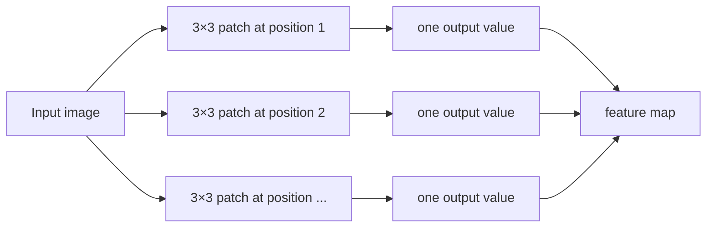
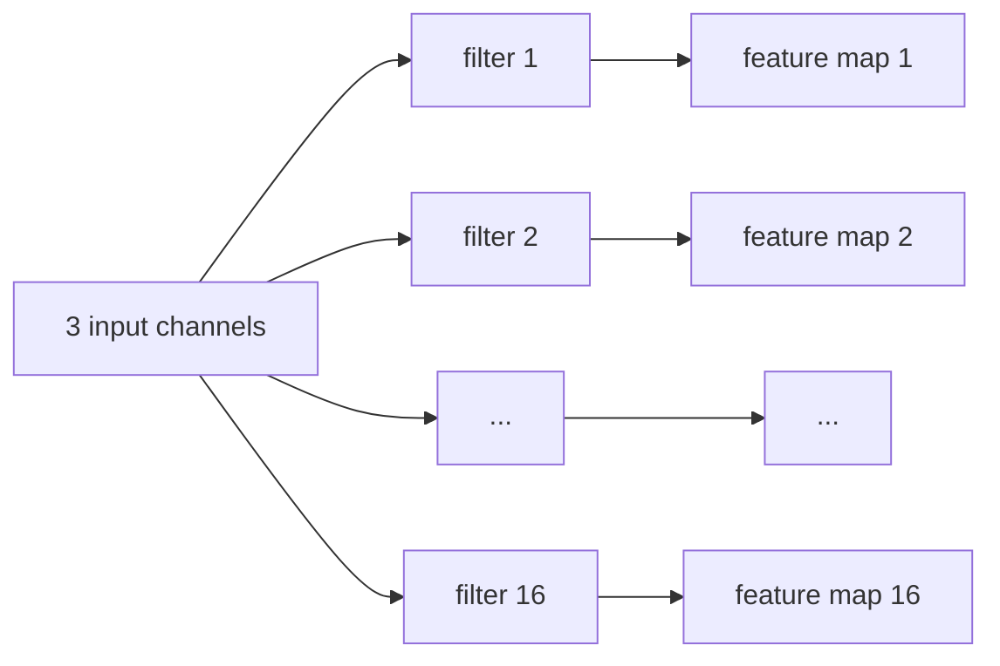
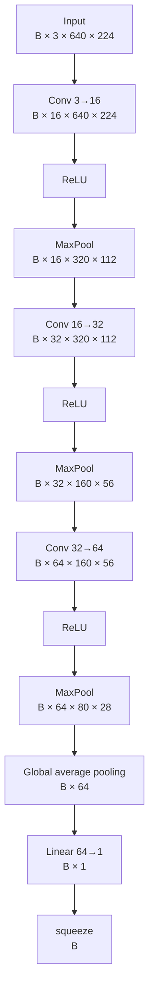

# CNN basics — our baseline classifier

This note explains the concepts used in `BaselineCNN` and connects each idea to the actual tensors that move through the model.

The goal is not only to know the definitions, but to be able to follow one image through the network and explain what each layer does, why it is there and how the tensor changes.

## What is a CNN?

A Convolutional Neural Network (CNN) is a neural network designed to learn spatial patterns in images.

Instead of connecting every input pixel directly to every neuron, a convolution uses a small learnable kernel that slides across the image. The same kernel is reused at every spatial position, which makes CNNs efficient and well suited to visual patterns.

In this project, the M2 baseline uses a CNN for **binary image classification**:

- `0` = clean image;
- `1` = defective image.

The segmentation mask is not predicted in M2. It is used only to derive the image-level label stored in the manifest. Pixel-level localization comes later in the segmentation milestones.

## Input tensor

The dataset returns images with shape:

```text
[C, H, W] = [3, 640, 224]
```

A `DataLoader` groups several images into a batch:

```text
[B, C, H, W]
```

For example, with batch size 4:

```text
[4, 3, 640, 224]
```

`B` is the batch size, `C` the number of channels, and `H × W` the spatial resolution.

There is no explicit `Input` layer in our PyTorch model. The input tensor is passed directly to the first convolution.

## Convolution layers and filters

Our first layer is:

```python
nn.Conv2d(3, 16, kernel_size=3, padding=1)
```

It means:

- `3` input channels: RGB;
- `16` output channels;
- each learned kernel has spatial size `3 × 3`;
- `padding=1` adds one pixel around the image, so the spatial size is preserved;
- the default stride is `1`.

The layer therefore changes:

```text
[B, 3, 640, 224]
        ↓
[B, 16, 640, 224]
```

The 16 output channels are also called **feature maps**.

### Visual intuition: the kernel is a sliding patch

A `3 × 3` kernel does not look at the whole image at once. It reads one local patch, computes one output value, then moves to the next position.

```text
Image

┌───┬───┬───┬───┬───┐
│ 1 │ 2 │ 3 │ 4 │ 5 │
├───┼───┼───┼───┼───┤
│ 6 │ 7 │ 8 │ 9 │10 │
├───┼───┼───┼───┼───┤
│11 │12 │13 │14 │15 │
├───┼───┼───┼───┼───┤
│16 │17 │18 │19 │20 │
├───┼───┼───┼───┼───┤
│21 │22 │23 │24 │25 │
└───┴───┴───┴───┴───┘

First 3×3 patch

┏━━━┳━━━┳━━━┓
┃ 1 ┃ 2 ┃ 3 ┃
┣━━━╋━━━╋━━━┫
┃ 6 ┃ 7 ┃ 8 ┃
┣━━━╋━━━╋━━━┫
┃11 ┃12 ┃13 ┃
┗━━━┻━━━┻━━━┛

With stride = 1, the kernel then moves one position to the right.
```

The interactive version is available at:

`docs/learning/visuals/convolution-kernel-demo.html`

That demo uses one channel and fixed example weights only to make the mechanism visible. In our real first layer, a filter spans all three RGB channels and its weights are learned during training.

### One filter produces one feature map

The same learned filter is reused at every spatial position.



So:

```text
one learned filter
        ↓
one feature map
```

Our first convolution has 16 filters, so it produces 16 feature maps.

Because the input has 3 channels, one filter in the first convolution actually has shape:

```text
[3, 3, 3]
 input channels × kernel height × kernel width
```

A useful visual model is:



The filters are **learned during training**. We do not manually tell them to detect edges or textures. Early filters often learn simple visual patterns such as edges, contrasts or local textures, while later layers can combine simpler patterns into more complex representations.

The second convolution is:

```python
nn.Conv2d(16, 32, kernel_size=3, padding=1)
```

Each of its 32 filters sees all 16 feature maps from the previous layer. Its output is:

```text
[B, 32, H, W]
```

The third convolution follows the same idea with `32 → 64` channels.

## Channels and spatial size are different axes

The first layer changes:

```text
[B, 3, 640, 224]
        ↓ Conv 3→16
[B,16, 640, 224]
```

The spatial size stays the same because we use `kernel_size=3`, `stride=1`, `padding=1`.

The number of channels changes because we ask the layer to learn 16 different filters.

This distinction is important:

```text
channels = learned representations
H × W    = spatial resolution
```

## Why channels increase

As the network becomes deeper, spatial resolution is reduced while the number of feature maps increases:

```text
3 → 16 → 32 → 64 channels
```

A useful mental model is:

```text
less spatial detail
+
more learned visual representations
```

The model progressively compresses the image while representing increasingly useful patterns in its channels.

## ReLU and non-linearity

After every convolution we use:

```python
nn.ReLU()
```

ReLU is:

```text
ReLU(x) = max(0, x)
```

So:

```text
before ReLU     after ReLU

 -2.0              0.0
 -0.3              0.0
  0.0              0.0
  1.5              1.5
  4.2              4.2
```

ReLU introduces **non-linearity**.

This matters because convolution and linear layers are affine transformations. If we stacked only affine transformations, their composition could still be represented by a single affine transformation. Making the network deeper would not give it the expressive power needed to learn complex non-linear decision boundaries.

ReLU breaks that purely linear composition and allows the network to represent much more complex relationships between image patterns and the final class.

ReLU changes values, not tensor shape:

```text
[B, C, H, W] → [B, C, H, W]
```

## Max pooling

After each ReLU we use:

```python
nn.MaxPool2d(2)
```

A `2 × 2` max-pooling operation looks at each local region and keeps only its largest value.

```text
┌───┬───┐
│ 1 │ 5 │
├───┼───┤
│ 2 │ 3 │
└───┴───┘

MaxPool → 5
```

With the default stride of 2, it halves both spatial dimensions:

```text
640 × 224 → 320 × 112
320 × 112 → 160 × 56
160 × 56  → 80 × 28
```

Max pooling does **not** change the number of channels.

Its role is to reduce spatial resolution, computation and sensitivity to small local shifts while keeping strong activations.

The trade-off is that pooling also discards spatial information. That is acceptable for this simple image-level classifier, but localization tasks such as semantic segmentation need to preserve or recover spatial detail much more carefully.

## Full shape flow through our CNN

Our current architecture is:



The same flow as a table:

| Stage | Shape |
|---|---|
| Input | `[B, 3, 640, 224]` |
| Conv 3→16 | `[B, 16, 640, 224]` |
| ReLU | `[B, 16, 640, 224]` |
| MaxPool | `[B, 16, 320, 112]` |
| Conv 16→32 | `[B, 32, 320, 112]` |
| ReLU | `[B, 32, 320, 112]` |
| MaxPool | `[B, 32, 160, 56]` |
| Conv 32→64 | `[B, 64, 160, 56]` |
| ReLU | `[B, 64, 160, 56]` |
| MaxPool | `[B, 64, 80, 28]` |
| Global average pooling | `[B, 64]` |
| Linear 64→1 | `[B, 1]` |
| `squeeze(1)` | `[B]` |

The broad trend is:

```text
spatial resolution: 640×224 → 320×112 → 160×56 → 80×28
channels:                    3 → 16 → 32 → 64
```

## Intermediate layers

The convolution, ReLU and max-pooling operations form the **feature extractor**.

Their job is not to output the final class directly. They transform raw pixels into learned features that are easier to classify.

In our code, these layers live in:

```python
self.features = nn.Sequential(...)
```

The final `Linear` layer is the **classifier head**:

```python
self.classifier = nn.Linear(64, 1)
```

It takes the learned 64-dimensional representation of each image and converts it into one classification score.

A useful mental model is:


The feature extractor learns **what visual evidence exists**; the classifier head combines that evidence into the binary decision.

## Global average pooling

After the last max-pooling layer the tensor still has spatial dimensions:

```text
[B, 64, 80, 28]
```

We use:

```python
features.mean(dim=(2, 3))
```

This averages every `80 × 28` feature map into one number:

```text
[B, 64, 80, 28]
        ↓
[B, 64]
```

This is a form of **global average pooling**.

It is different from `MaxPool2d`:

- `MaxPool2d` repeatedly reduces local spatial regions and keeps the maximum;
- global average pooling collapses the entire remaining spatial map by taking its mean.

Using global average pooling keeps the classifier small. We avoid flattening `64 × 80 × 28` values into a huge fully connected layer.

## Output layer and binary classification

The classifier is:

```python
nn.Linear(64, 1)
```

It outputs one real number per image:

```text
[B]
```

That number is a **logit**.

A logit is not a probability. It can take any real value:

```text
-3.1
 0.0
 2.7
```

For binary classification we convert the logit into a probability with the sigmoid function:

```text
p(defect) = sigmoid(logit)
```

Conceptually:

```text
large negative logit ───── 0 ───── large positive logit
      likely clean        0.5         likely defective
                         after sigmoid
```

With a probability threshold of `0.5`:

```text
p < 0.5 → clean
p ≥ 0.5 → defective
```

Because `sigmoid(0) = 0.5`, this is equivalent to using a logit threshold of `0`.

### Why one output neuron?

Our problem is binary:

```text
clean vs defective
```

One logit is enough to model `P(defective)`. Once that probability is known:

```text
P(clean) = 1 - P(defective)
```

A two-output softmax classifier would also work, but it would be unnecessary for this simple binary case.

## Where `BCEWithLogitsLoss` fits

During training we will use `BCEWithLogitsLoss`.

It expects raw logits and internally combines the binary cross-entropy calculation with the sigmoid operation in a numerically stable way.

So we should **not** apply sigmoid before passing predictions to the loss.

Conceptually:

```text
logit + true label
      ↓
BCEWithLogitsLoss
      ↓
loss
```

A confident wrong prediction should produce a large loss, while a confident correct prediction should produce a small loss.

## The complete mental model

```text
RGB image
   ↓
Conv
learn local visual patterns
   ↓
ReLU
introduce non-linearity
   ↓
MaxPool
reduce spatial resolution
   ↓
Conv
combine earlier patterns
   ↓
ReLU
   ↓
MaxPool
   ↓
Conv
build richer features
   ↓
ReLU
   ↓
MaxPool
   ↓
64 feature maps
   ↓
Global Average Pool
   ↓
64 numbers
   ↓
Linear
   ↓
1 logit
   ↓
Sigmoid for interpretation
   ↓
P(defect)
```

## Parameter count

The current model has 23,649 trainable parameters.

Approximate breakdown:

```text
Conv 3 → 16:    448
Conv 16 → 32: 4,640
Conv 32 → 64: 18,496
Linear 64 → 1:    65
----------------------
Total:          23,649
```

These parameters are the filter weights and biases that will be updated by gradient descent during training.

## Why do we need this baseline?

The goal of this model is not to be state of the art.

It gives us a model simple enough to understand end to end while learning:

- convolution;
- filters and feature maps;
- activation functions;
- pooling;
- tensor shapes;
- logits and binary classification;
- loss and backpropagation;
- optimization;
- overfitting and validation behavior.

Later, transfer learning will let us compare this small network with a pretrained architecture.

## Alternatives and trade-offs

### No pooling

We could preserve more spatial information, but tensors would stay large and computation would increase.

### Strided convolutions instead of max pooling

A convolution with stride greater than 1 can learn the downsampling operation. It is more flexible but slightly less simple for our first baseline.

### Flatten instead of global average pooling

Flattening `[64, 80, 28]` would create 143,360 features per image before the classifier. Connecting all of them to fully connected layers would add many parameters and increase overfitting risk.

### Other activation functions

GELU, SiLU and LeakyReLU are common alternatives. ReLU is used here because it is simple, standard and sufficient for the baseline.

## Common mistakes

- Thinking convolution filters are manually chosen. Their weights are learned during training.
- Confusing channels with spatial dimensions.
- Thinking a kernel sees the entire image at once instead of a local patch.
- Assuming ReLU changes tensor size. It changes values, not shape.
- Assuming max pooling increases channels. It reduces spatial dimensions only.
- Confusing max pooling with global average pooling.
- Applying the same interpolation idea to images and segmentation masks. Masks represent discrete labels.
- Treating a logit as a probability.
- Applying sigmoid before `BCEWithLogitsLoss`.
- Using classification accuracy alone on an imbalanced dataset without checking class-specific behavior.
- Forgetting that aggressive pooling can destroy spatial information needed for localization.

## Interview explanation

A concise explanation of our baseline could be:

> The baseline is a small three-block CNN for binary defect classification. Each block uses a 3×3 convolution, ReLU and 2×2 max pooling. The convolutions progressively increase channels from 3 to 16, 32 and 64, while pooling reduces the spatial resolution from 640×224 to 80×28. Global average pooling converts the final feature maps into a 64-dimensional vector, and a linear layer outputs one logit per image. During training the logits are used directly with BCEWithLogitsLoss; sigmoid is only needed when we want to interpret the score as a defect probability.

## Questions I should be able to answer

1. What does `Conv2d(3, 16, kernel_size=3, padding=1)` mean?
2. Why does a `3 × 3` kernel behave like a sliding patch?
3. Why does the first convolution output 16 channels?
4. Why does a convolutional filter span all input channels?
5. Why do we need a non-linear activation such as ReLU?
6. What would happen if every layer were linear?
7. What does max pooling do to `H`, `W` and `C`?
8. What is the difference between max pooling and global average pooling?
9. Why do channels increase while spatial dimensions decrease?
10. What is a feature map?
11. What is a logit and how is it converted into a probability?
12. Why does our binary classifier have one output neuron instead of two?
13. Why should we not apply sigmoid before `BCEWithLogitsLoss`?
14. Why is this architecture suitable as a baseline but not necessarily as the final model?

## Evidence

- Code: `src/industrial_vision/models/baseline_cnn.py`
- Test: `tests/test_baseline_cnn.py`
- Interactive convolution demo: `docs/learning/visuals/convolution-kernel-demo.html`
- Baseline implementation commit: `d2a540d`
