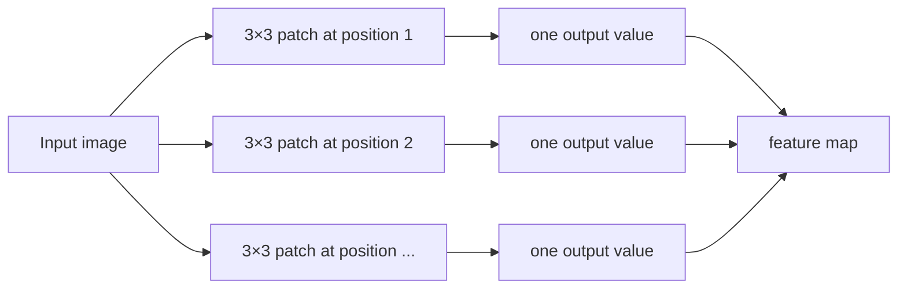
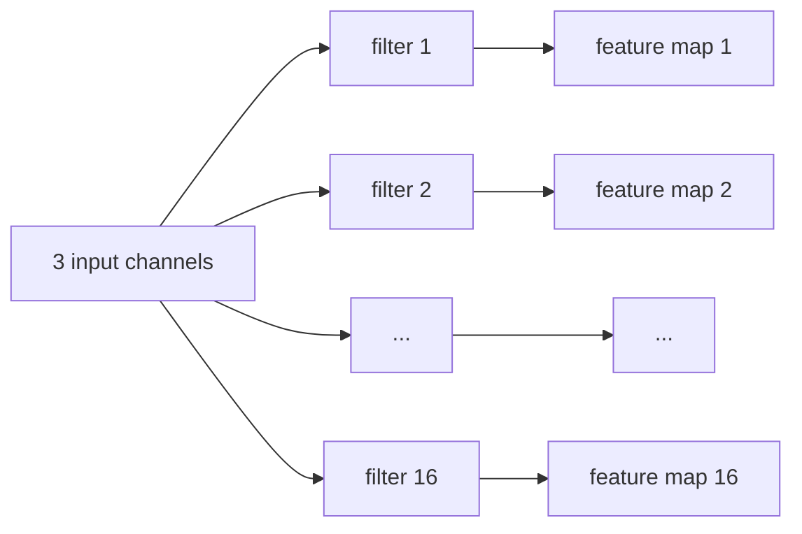
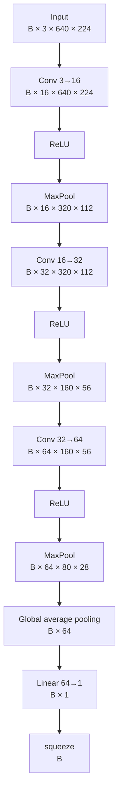

# CNN visual guide — baseline classifier

This is the visual companion to `cnn-basics.md`.

Use it when the spatial intuition is more important than the formal definition.

## 1. A convolution kernel is a sliding patch

A `3×3` kernel does not look at the whole image at once. It reads one local `3×3` patch, computes a weighted sum, then moves to the next position.

```text
Image

┌───┬───┬───┬───┬───┐
│ 1 │ 2 │ 3 │ 4 │ 5 │
├───┼───┼───┼───┼───┤
│ 6 │ 7 │ 8 │ 9 │10 │
├───┼───┼───┼───┼───┤
│11 │12 │13 │14 │15 │
├───┼───┼───┼───┼───┤
│16 │17 │18 │19 │20 │
├───┼───┼───┼───┼───┤
│21 │22 │23 │24 │25 │
└───┴───┴───┴───┴───┘

First 3×3 patch

┏━━━┳━━━┳━━━┓
┃ 1 ┃ 2 ┃ 3 ┃
┣━━━╋━━━╋━━━┫
┃ 6 ┃ 7 ┃ 8 ┃
┣━━━╋━━━╋━━━┫
┃11 ┃12 ┃13 ┃
┗━━━┻━━━┻━━━┛

Then it moves one position to the right when stride = 1.
```

Open the interactive version:

`docs/learning/visuals/convolution-kernel-demo.html`

The demo uses one channel and fixed example weights only to make the mechanism visible. In our real first layer, a filter spans all three RGB channels and its weights are learned.

## 2. What one filter produces

One filter is reused across all spatial positions.



So:

```text
one learned filter
        ↓
one feature map
```

Our first convolution has 16 filters, therefore it produces 16 feature maps.

## 3. Channels and spatial size are different axes

The first layer changes:

```text
[B, 3, 640, 224]
        ↓ Conv 3→16
[B,16, 640, 224]
```

The spatial size stays the same because we use `kernel_size=3`, `stride=1`, `padding=1`.

The number of channels changes because we ask the layer to learn 16 different filters.



## 4. ReLU changes values, not shape

```text
before ReLU     after ReLU

 -2.0              0.0
 -0.3              0.0
  0.0              0.0
  1.5              1.5
  4.2              4.2
```

Its shape is:

```text
[B, C, H, W] → [B, C, H, W]
```

The important role is not dimensionality reduction. It is introducing non-linearity between learned transformations.

## 5. MaxPool is a local reduction

For a `2×2` region:

```text
┌───┬───┐
│ 1 │ 5 │
├───┼───┤
│ 2 │ 3 │
└───┴───┘

MaxPool → 5
```

Applied across the whole feature map with stride 2:

```text
H × W
 ↓
H/2 × W/2
```

Channels do not change.

## 6. Our complete shape flow



The broad trend is:

```text
spatial resolution: 640×224 → 320×112 → 160×56 → 80×28
channels:                    3 → 16 → 32 → 64
```

## 7. Classification at the end

After global average pooling, every image is represented by 64 numbers:

```text
[B, 64]
```

The final linear layer combines them into one raw score:

```text
[B, 64]
   ↓ Linear 64→1
[B, 1]
   ↓ squeeze
[B]
```

That raw score is the logit.

```text
large negative logit ───── 0 ───── large positive logit
      likely clean        0.5         likely defective
                         after sigmoid
```

Sigmoid maps the logit to `p(defect)` between 0 and 1.

## 8. Mental model of the whole network


The feature extractor learns *what visual evidence exists*; the classifier head combines that evidence into the binary decision.
