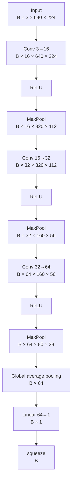

# CNN baseline — study index

These notes are the durable study record for the M2 CNN baseline. They are organized by concept so that a future review does not require searching through one long document.

The model studied here is `BaselineCNN`, used for binary image classification:

- `0` = clean image;
- `1` = defective image.

Pixel-level localization comes later in the segmentation milestones.

## Suggested reading order

1. [Tensors](topics/tensors.md) — tensors, shapes, weight tensors and activation tensors.
2. [Convolution](topics/convolution.md) — CNN meaning, patch, kernel, filter, stride, channels, feature maps and spatial resolution.
3. [Activations](topics/activations.md) — ReLU, non-linearity, when it is applied and why we use it.
4. [Pooling](topics/pooling.md) — MaxPool, spatial compression, global average pooling, flatten and squeeze.
5. [Classifier and loss](topics/classifier-and-loss.md) — linear head, logits, sigmoid and `BCEWithLogitsLoss`.

The interactive convolution demo is at:

`docs/learning/visuals/convolution-kernel-demo.html`

## Baseline architecture



The broad pattern is:

```text
spatial resolution: 640×224 → 320×112 → 160×56 → 80×28
channels:                    3 → 16 → 32 → 64
```

Two different operations create that pattern:

```text
Conv
→ learns new feature maps / can increase channels

MaxPool
→ reduces spatial resolution
```

## Complete forward-pass mental model

```text
RGB image
      ↓
Conv → ReLU → MaxPool
      ↓
Conv → ReLU → MaxPool
      ↓
Conv → ReLU → MaxPool
      ↓
64 final feature maps
      ↓
Global Average Pooling
      ↓
64 values
      ↓
Linear 64→1
      ↓
logit
      ↓
BCEWithLogitsLoss + true label
      ↓
loss
```

Everything below the loss belongs to the next study block:

```text
loss
 ↓
backpropagation
 ↓
gradients
 ↓
optimizer
 ↓
updated weights
```

## Why this baseline exists

The goal is not to be state of the art. It is deliberately small enough to understand end to end before moving to transfer learning and segmentation.

By the end of M2, the architecture should be explainable without treating convolution, activations, pooling, logits or loss as black boxes.

## Evidence

- Code: `src/industrial_vision/models/baseline_cnn.py`
- Test: `tests/test_baseline_cnn.py`
- Interactive convolution demo: `docs/learning/visuals/convolution-kernel-demo.html`
- Baseline implementation commit: `d2a540d`
