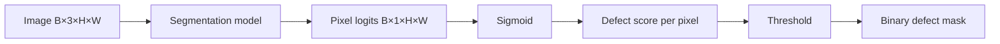

# Semantic segmentation

This section records the concepts used from M4 onward, where the project moves from image-level defect classification to pixel-level defect localization and then compares a scratch U-Net baseline with a modern pretrained segmentation model.

## Reading order

1. [Encoder, decoder, bottleneck and U-Net skip connections](topics/encoder-decoder-and-unet.md)
2. [Pixel logits](topics/pixel-logits.md) — how the network produces one learned defect logit at every spatial position.
3. [Upsampling](topics/upsampling.md) — how a decoder increases spatial resolution and why enlargement alone does not restore lost detail.
4. [Pixel imbalance, IoU and Dice](topics/pixel-imbalance-iou-and-dice.md) — why pixel accuracy is misleading and how overlap metrics evaluate defect masks.
5. [Simple U-Net forward pass](topics/simple-unet-forward-pass.md) — the first implemented M4 model, followed tensor by tensor through encoder, bottleneck, decoder and skips.
6. [Segmentation losses](topics/segmentation-losses.md) — plain BCE, weighted BCE, soft Dice loss and why the first baseline uses BCE + Dice.
7. [Atrous / dilated convolution](topics/atrous-convolution.md) — how dilation enlarges receptive field without increasing the learned kernel size.
8. [Atrous Spatial Pyramid Pooling (ASPP)](topics/aspp.md) — how DeepLab combines local, dilated and global context at several spatial scales.
9. [DeepLabV3-ResNet50](topics/deeplabv3-resnet50.md) — pretrained ResNet50 features, ASPP, the binary segmentation head and the comparison against SimpleUNet.

For a cross-project visual summary of every architecture studied so far, see the [architecture atlas](../architectures/README.md).

## Core mental model

Classification answers whether an image contains a defect. Semantic segmentation assigns a class to each pixel.

For binary defect segmentation, the model should transform an image tensor shaped `[B, 3, H, W]` into one defect logit per pixel shaped `[B, 1, H, W]`.

The first implemented M4 model is `SimpleUNet` in:

`src/industrial_vision/models/simple_unet.py`

Its first training baseline uses `BCEWithLogitsLoss + soft Dice loss`, implemented in:

`src/industrial_vision/training/segmentation.py`

and trained by:

`scripts/train_simple_unet.py`

M5 adds a pretrained `DeepLabV3-ResNet50` model in:

`src/industrial_vision/models/deeplabv3.py`

trained by:

`scripts/train_deeplabv3.py`

Both models obey the same output contract and reuse the same segmentation loss, metrics and train/evaluation loop. That lets EXP-014 compare model families without duplicating the rest of the pipeline.

## Study questions

By the end of M4/M5, we should be able to answer:

- Why does segmentation need spatial output instead of a single logit?
- What is the role of the encoder?
- What is the role of the decoder?
- What is the bottleneck?
- Why can downsampling hurt localization?
- What does upsampling do, and what can it not recover by itself?
- Why does U-Net copy high-resolution encoder features into the decoder?
- How are U-Net skip connections different from ResNet residual connections?
- How does the final layer produce one logit per pixel?
- What shape should a binary segmentation model output?
- Why can pixel accuracy be misleading for small defects?
- What do IoU and Dice measure?
- Why can plain BCE be dominated by background pixels?
- Why does the first segmentation baseline combine BCE and Dice loss?
- How do pixel-level losses and metrics differ from image-level classification metrics?
- Can we follow the implemented U-Net shapes through every encoder and decoder stage?
- What does a ResNet50 backbone contribute to DeepLabV3?
- What are atrous/dilated convolutions?
- How does dilation change receptive field without increasing the learned kernel size?
- What is ASPP and why does multi-scale context help segmentation?
- How is ASPP different from U-Net skip connections?
- Why does a pretrained model require matching input normalization?
- Why can a larger pretrained model still fail to beat a smaller scratch baseline?
