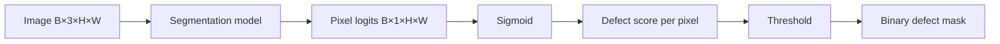

# Semantic segmentation

This section records the concepts used in M4, where the project moves from image-level defect classification to pixel-level defect localization.

## Reading order

1. [Encoder, decoder and U-Net skip connections](topics/encoder-decoder-and-unet.md)

## Core mental model

Classification answers whether an image contains a defect. Semantic segmentation assigns a class to each pixel.

For binary defect segmentation, the model should transform an image tensor shaped `[B, 3, H, W]` into one defect logit per pixel shaped `[B, 1, H, W]`.

M4 focuses first on understanding and implementing a simple encoder-decoder segmentation model before moving to a modern pretrained segmentation model in M5.

## M4 questions

By the end of M4, we should be able to answer:

- Why does segmentation need spatial output instead of a single logit?
- What is the role of the encoder?
- What is the role of the decoder?
- Why can downsampling hurt localization?
- Why does U-Net copy high-resolution encoder features into the decoder?
- How are U-Net skip connections different from ResNet residual connections?
- What shape should a binary segmentation model output?
- How do pixel-level losses and metrics differ from image-level classification metrics?
