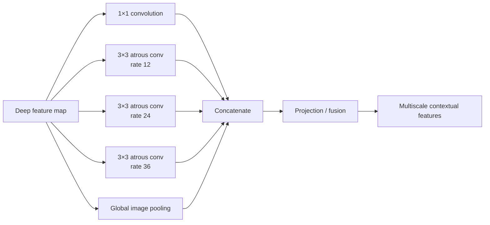

# Atrous Spatial Pyramid Pooling (ASPP)

## What it is

**ASPP = Atrous Spatial Pyramid Pooling**.

It is one of the defining ideas of DeepLabV3.

Instead of processing the deepest feature map at only one spatial scale, ASPP sends the same feature map through several parallel branches with different receptive fields and then combines them.

Mental model:



In torchvision's `DeepLabHead`, the default atrous rates are `(12, 24, 36)`.

---

## Why a spatial pyramid?

A defect can have useful evidence at different scales.

A small local region may reveal:

- a sharp edge;
- a tiny pit;
- a local texture break.

A larger context may reveal:

- whether that mark belongs to a longer scratch;
- whether it follows normal steel texture;
- whether the surrounding region makes the local pattern suspicious.

ASPP tries to preserve several views of the same location:

```text
local context
medium context
large context
global image context
```

and fuse them before the final pixel classifier.

---

## The branches

### 1×1 branch

```text
1×1 convolution
```

Looks at each spatial position without expanding the receptive field in that layer.

It provides a relatively local representation and channel transformation.

### Atrous branches

Several parallel `3×3` convolutions use different dilation rates.

```text
rate 12 -> one receptive scale
rate 24 -> wider scale
rate 36 -> even wider scale
```

They contain the same basic idea as dilated convolution but sample the feature map at different spacings.

### Image-pooling branch

This branch summarizes the feature map globally.

Conceptually:

```text
feature map
   ↓
global average pooling
   ↓
1×1 feature
   ↓
transform
   ↓
upsample back to feature-map size
```

This gives every spatial position access to a representation of the whole image.

---

## Why concatenate the branches?

Each branch produces a different view of the same deep feature map.

If we used only one dilation rate, the model would commit to one context scale.

Instead:

```text
branch 1 ┐
branch 2 ├─ concatenate → learned projection → fused context
branch 3 ┤
branch 4 ┤
global   ┘
```

The following projection layers can learn how much each type of context matters for the target task.

---

## ASPP in our current network

Our EXP-014 model is:

```text
RGB image
   ↓
ImageNet normalization
   ↓
ResNet50 backbone
   ↓
deep feature map
   ↓
ASPP
   ↓
DeepLab classifier layers
   ↓
1 defect logit per pixel
   ↓
upsample to input spatial size
```

The important distinction is:

```text
ResNet50 = backbone / feature extractor
ASPP     = multiscale context module
DeepLabV3 classifier = converts contextual features into segmentation logits
```

---

## ASPP versus U-Net skip connections

They solve related but different problems.

### U-Net skips

Copy earlier high-resolution encoder features into the decoder.

Main goal:

```text
recover fine localization detail
```

### ASPP

Processes deep features at multiple receptive-field scales.

Main goal:

```text
capture multiscale context
```

So:

| Mechanism | Main information added |
|---|---|
| U-Net skip connections | fine spatial detail from earlier layers |
| ASPP | context at several spatial scales from deep layers |

DeepLabV3 does not use the symmetric U-Net decoder with matching encoder skips.

---

## ASPP versus simply using a larger kernel

A large dense kernel could also increase receptive field, but it would add many more parameters and computation.

Atrous convolutions enlarge the sampled spatial region while keeping a small learned kernel such as `3×3`.

ASPP then combines several such receptive fields rather than choosing only one.

---

## BatchNorm and the smoke-test failure

The ASPP global-pooling branch is also where our first DeepLab smoke test exposed a BatchNorm edge case.

After global pooling, one branch temporarily produced a tensor shaped:

```text
[1, 256, 1, 1]
```

for the final singleton training batch.

That gives BatchNorm only one value per channel during training, which is insufficient to estimate batch statistics.

The model itself was not out of GPU memory.

The minimal fix was:

```python
drop_last=True
```

for the training DataLoader, while validation still evaluates every image.

This is a useful example of why understanding architecture internals matters when debugging runtime errors.

---

## Trade-offs

Advantages:

- strong multiscale context;
- larger receptive fields without proportionally larger kernels;
- works well for dense prediction;
- global context branch complements local features.

Costs / risks:

- more computation than a single branch;
- more memory than a simpler segmentation head;
- very large dilation can sample features sparsely;
- does not directly restore early high-resolution features like U-Net skips do.

---

## Interview explanation

> ASPP is the multiscale context module in DeepLabV3. It processes the same deep feature map through parallel branches: a local 1×1 path, several dilated 3×3 convolutions with different dilation rates, and a global pooling branch. Their outputs are concatenated and fused, so each pixel prediction can use context at several spatial scales without relying only on additional downsampling.

## Questions to be able to answer

1. What does ASPP stand for?
2. Why does it use several dilation rates in parallel?
3. What does the global pooling branch contribute?
4. How is ASPP different from U-Net skip connections?
5. Why not simply use a huge dense convolution kernel?
6. Where did BatchNorm appear in our ASPP smoke-test failure?
