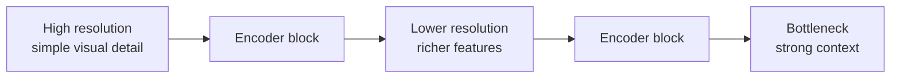
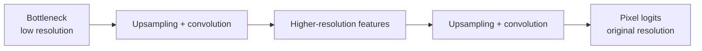
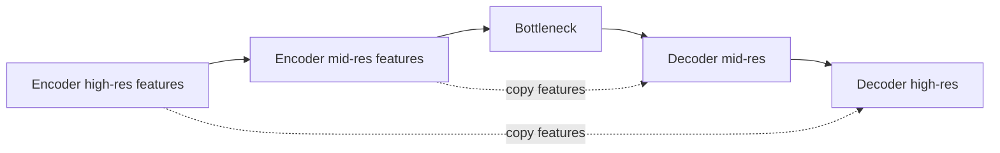

# Encoder, decoder and U-Net skip connections

## Why classification architecture is not enough

A classification model can progressively reduce spatial resolution because its final question is global: does the image contain a defect?

Semantic segmentation asks a different question: which pixels belong to the defect?

That means the model must preserve enough spatial information to produce an output mask aligned with the input image.

For binary segmentation:

- input: `[B, 3, H, W]`;
- target mask: `[B, 1, H, W]`;
- output logits: `[B, 1, H, W]`.

Each output location corresponds to one pixel-level defect decision.

## Encoder

The encoder progressively transforms the image into richer feature maps while usually reducing spatial resolution.

Conceptually:



Downsampling is useful because deeper features gain a larger receptive field and can represent more context.

The cost is localization precision. Fine edges and small structures become harder to recover after repeated spatial compression.

## Bottleneck

The bottleneck is the deepest, most compressed representation between encoder and decoder.

It contains strong semantic/contextual information but relatively coarse spatial detail.

Mental model:

> The encoder answers increasingly well what visual structures are present, but becomes progressively less precise about their exact pixel boundaries.

## Decoder

The decoder progressively increases spatial resolution again so the network can produce a dense mask.



Upsampling can recover resolution, but it cannot magically reconstruct fine information that was discarded by the encoder.

This is the key motivation for U-Net skip connections.

## U-Net skip connections

U-Net connects encoder and decoder stages that operate at matching spatial resolutions.



The decoder receives two complementary kinds of information:

- deep decoder features: semantic/context information;
- encoder skip features: fine spatial detail from before stronger downsampling.

In the original U-Net style, these features are usually concatenated along the channel dimension.

If both tensors have shape `[B, C, H, W]`, concatenating them along channels produces something like `[B, 2C, H, W]` before the following convolution block.

The exact channel counts depend on the architecture.

## Why this matters for KSDD2

Our earlier classification error analysis showed that missed defects were often small and localized. That makes spatial detail especially important.

A segmentation model that compresses the image and only relies on the bottleneck would risk losing precisely the thin or localized structures we need to outline.

U-Net skip connections give the decoder access to high-resolution encoder features while still using deeper context to decide whether those local structures correspond to a defect.

## ResNet residual connections vs U-Net skip connections

Both are called skip connections, but they solve different problems.

### ResNet residual connection

Typical operation:

```math
H(x)=F(x)+x
```

The input bypasses a transformation and is added back to its output.

Purpose:

- help optimization of deep networks;
- provide a direct information/gradient path;
- learn a residual correction instead of an entirely new representation.

### U-Net skip connection

Encoder features are transferred to a later decoder stage, usually by concatenation.

Purpose:

- recover high-resolution spatial information;
- combine localization detail with deep semantic context.

Mental distinction:

> ResNet skips mainly help deep feature learning and optimization. U-Net skips mainly help spatial reconstruction and localization.

## Classification output vs segmentation output

Classification:

```text
[B, 3, H, W] -> [B]
```

One logit per image.

Binary semantic segmentation:

```text
[B, 3, H, W] -> [B, 1, H, W]
```

One logit per pixel.

A sigmoid can later convert each pixel logit into a defect score. A threshold converts those scores into a binary mask.

Just as in classification, the model should normally output logits during training rather than applying sigmoid before a numerically stable loss such as `BCEWithLogitsLoss`.

## What the model must learn

The network must learn both:

1. semantic recognition: does this local visual pattern look like a defect?
2. localization: which exact pixels belong to that defect?

This is why segmentation is harder than image-level classification but also much more aligned with the final industrial inspection product.

## Common mistakes

- Treating segmentation as classification and collapsing all spatial dimensions before the output.
- Applying image interpolation rules to masks; binary masks should use nearest-neighbor resizing to avoid inventing intermediate labels.
- Assuming upsampling alone restores information lost during downsampling.
- Confusing ResNet residual additions with U-Net encoder-to-decoder feature transfer.
- Applying sigmoid before `BCEWithLogitsLoss`.

## Interview explanation

A concise explanation is:

> A segmentation network must preserve and reconstruct spatial information because it predicts one class per pixel. U-Net uses an encoder to learn increasingly contextual features and a decoder to recover spatial resolution. Since repeated downsampling loses fine localization detail, skip connections copy high-resolution encoder features into matching decoder stages, where they are combined with deeper semantic features. This is different from ResNet residual connections, which add an input to a transformed representation mainly to improve optimization and information flow in deep networks.

## Questions to be able to answer

1. Why can classification models aggressively discard spatial information?
2. What information does the encoder gain as resolution decreases?
3. What information does the encoder lose?
4. Why is a decoder necessary for segmentation?
5. Why is upsampling alone insufficient?
6. What exactly is transferred through a U-Net skip connection?
7. Why are small KSDD2 defects a strong motivation for skip connections?
8. How does a U-Net skip differ from a ResNet residual connection?
9. What output shape should binary segmentation produce?
10. Why should segmentation training usually work with logits instead of already-thresholded masks?
