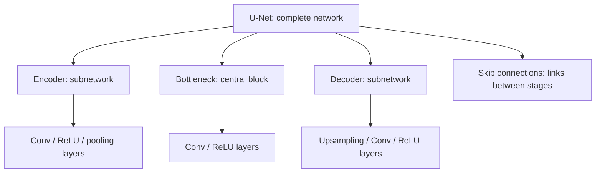
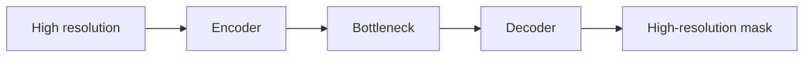
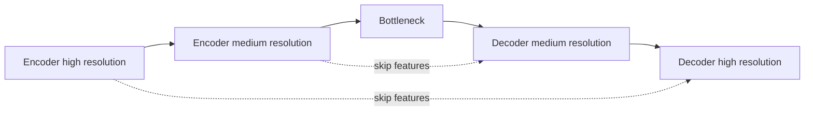
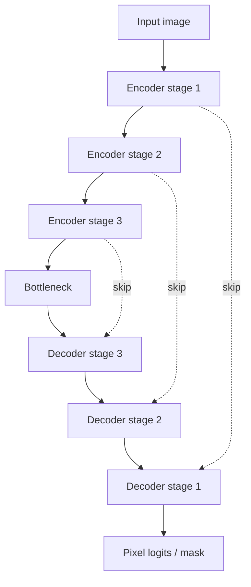

# Encoder, decoder, bottleneck and U-Net skip connections

## First: what kind of thing is each term?

Before studying U-Net, distinguish the level at which each word lives.

- `Conv2d`, `ReLU`, `MaxPool2d`, interpolation and similar operations are **layers or operations**.
- an **encoder** is not one layer: it is a **subnetwork** made of multiple layers;
- a **decoder** is also a subnetwork made of multiple layers;
- a **bottleneck** is the deepest and most compressed part between encoder and decoder; it is usually a small block of layers, not a single special layer;
- a **skip connection** is a connection that carries information from one part of the network to another part while bypassing intermediate layers;
- **U-Net** is the complete segmentation architecture that organizes an encoder, a bottleneck, a decoder and encoder-to-decoder skip connections.

Useful hierarchy:



## The global problem

Classification and segmentation ask different questions.

Classification asks:

> Does this image contain a defect?

A classification network can eventually compress the entire image into a vector because the final answer is global.

Binary semantic segmentation asks:

> For every pixel, is this pixel part of a defect or not?

For binary segmentation:

- input image: `[B, 3, H, W]`;
- ground-truth mask: `[B, 1, H, W]`;
- output logits: `[B, 1, H, W]`.

So the model must learn two things at the same time:

1. **recognition/context** — what visual patterns look like a defect;
2. **localization** — where the defect pixels are located.

This creates a tension: deep CNNs gain context by reducing spatial resolution, but segmentation ultimately needs high spatial resolution again.

U-Net is one architecture designed around that tension.

## Encoder: what exactly is it?

An encoder is a **role inside a neural network**, not a single predefined PyTorch layer.

It is usually a sequence of convolutional blocks and downsampling operations.

Example conceptually:

```text
input image
    ↓
conv + ReLU
conv + ReLU
    ↓
pooling
    ↓
conv + ReLU
conv + ReLU
    ↓
pooling
    ↓
...
```

All of those layers together can be called the **encoder**.

Its job is to transform the original pixels into increasingly useful feature maps.

Typically, as we go deeper:

- spatial dimensions `H` and `W` become smaller;
- channel count becomes larger;
- receptive field becomes larger;
- features represent more contextual or complex patterns.

For example:

```text
[B, 3, 640, 224]
       ↓
[B, 32, 640, 224]
       ↓ downsample
[B, 32, 320, 112]
       ↓
[B, 64, 320, 112]
       ↓ downsample
[B, 64, 160, 56]
```

The exact channel counts are architectural choices.

### Why reduce resolution?

Because it helps the network combine information from larger regions of the image.

A feature deep in the encoder can depend on a much larger part of the original image than one shallow feature.

This gives more context.

### What is the cost?

Fine spatial detail becomes less precise.

A very thin scratch may occupy many pixels in the original image but only a few positions after repeated downsampling.

So a useful mental model is:

> The encoder progressively trades spatial precision for richer visual/contextual representation.

## Bottleneck: what does "bottleneck" mean?

`Bottleneck` literally means **cuello de botella**.

It is not a special PyTorch class.

It describes the narrowest or most compressed part of the encoder-decoder architecture.

In a U-Net it sits between the downward encoder path and the upward decoder path.



At the bottleneck:

- spatial resolution is usually the lowest;
- feature channels are often the highest;
- each feature can represent information from a relatively large region of the input.

For example, a path could look like:

```text
640×224
↓
320×112
↓
160×56
↓
80×28   ← bottleneck resolution
```

The bottleneck therefore contains strong context, but localization is coarse.

It is called a bottleneck because a large amount of input information has been compressed into a smaller spatial representation before being expanded again.

It does **not** mean that the tensor must be small in number of total values; the important idea here is the compressed spatial representation between encoder and decoder.

## Decoder: what exactly is it?

The decoder is another **subnetwork**, not one layer.

Its job is to turn the low-resolution deep representation back into a high-resolution representation suitable for pixel prediction.

Conceptually:

```text
bottleneck
[B, 128, 80, 28]
       ↓ upsample
[B, ..., 160, 56]
       ↓ convs
       ↓ upsample
[B, ..., 320, 112]
       ↓ convs
       ↓ upsample
[B, ..., 640, 224]
```

At the end, a final convolution converts the decoder features into one output logit per pixel.

For example:

```python
nn.Conv2d(32, 1, kernel_size=1)
```

can convert `[B, 32, H, W]` into `[B, 1, H, W]`.

## Why is upsampling alone not enough?

Suppose the encoder reduced a small defect until its exact border became difficult to identify.

Increasing resolution later does not recreate the lost detail automatically.

Upsampling can make a tensor spatially larger, but it cannot know every fine detail that disappeared earlier.

This motivates skip connections.

## Skip connection: what exactly is a skip?

A skip connection is **a route that bypasses some intermediate layers and sends an earlier representation directly to a later part of the network**.

It is a connection pattern, not necessarily a particular layer.

In U-Net, an encoder stage sends its feature map directly to a decoder stage with the same spatial resolution.



The normal path is:

```text
encoder → deeper encoder → bottleneck → decoder
```

The skip is an additional shortcut such as:

```text
encoder stage ─────────────────→ matching decoder stage
```

That is why it is called `skip`: the information skips over the deeper intermediate layers.

## What travels through a U-Net skip?

Usually a full feature tensor from the encoder.

For example:

```text
encoder feature:
[B, 64, 160, 56]

current decoder feature:
[B, 64, 160, 56]
```

U-Net commonly concatenates them along the channel dimension:

```text
[B, 64, 160, 56]
+
[B, 64, 160, 56]

→ concatenate channels

[B, 128, 160, 56]
```

Then convolutional layers learn how to combine both sources of information.

The decoder therefore receives:

- deep/contextual information from the lower path;
- higher-resolution localization detail from the encoder skip.

Useful mental model:

> The deep path helps answer **what is it?** The skip helps answer **where exactly was it?**

This is an intuition, not a strict division: both tensors contain mixtures of semantic and spatial information.

## So what exactly is a U-Net?

U-Net is a **neural-network architecture for dense prediction, especially segmentation**.

It is the complete model, not one layer.

Its characteristic structure is:

1. an **encoder** that progressively reduces spatial resolution and extracts features;
2. a **bottleneck** at the deepest compressed representation;
3. a **decoder** that progressively recovers spatial resolution;
4. **skip connections** that copy feature maps from encoder stages to corresponding decoder stages.

The classic shape resembles a `U`, which is the origin of the name U-Net.



The left/downward path is the encoder.

The bottom is the bottleneck.

The right/upward path is the decoder.

The horizontal shortcuts are the U-Net skips.

## Why U-Net is useful for KSDD2

Our classification error analysis showed that many missed defects were small and localized.

That makes the segmentation problem especially sensitive to spatial detail.

The encoder gives the model enough context to distinguish a real defect from ordinary surface texture.

The decoder reconstructs a full-resolution prediction.

The skip connections provide higher-resolution feature maps that help preserve boundaries and thin structures.

This is one reason U-Net is a sensible educational baseline for this project.

It is not being chosen because every segmentation problem must use U-Net. It gives us a clear architecture for learning the core concepts before moving to pretrained segmentation models in M5.

## ResNet residual connections vs U-Net skip connections

Both are called skip connections because information bypasses intermediate transformations, but their usual implementation and main purpose differ.

### ResNet residual skip

Typical operation:

```math
H(x)=F(x)+x
```

The shortcut input is generally **added** to the transformed path.

Main purpose:

- make deep networks easier to optimize;
- provide direct information and gradient flow;
- let blocks learn residual corrections.

### U-Net encoder-decoder skip

An encoder feature map is sent to a later decoder stage, typically by **concatenation**.

Main purpose:

- restore localization detail;
- combine high-resolution encoder features with deep decoder context.

Mental distinction:

> ResNet skip: help information pass through depth.
>
> U-Net skip: bring earlier spatial detail back into reconstruction.

## Classification output vs segmentation output

Classification:

```text
[B, 3, H, W] → [B]
```

One logit per image.

Binary semantic segmentation:

```text
[B, 3, H, W] → [B, 1, H, W]
```

One logit per pixel.

A sigmoid can later convert each pixel logit into a defect score. A threshold converts those scores into a binary mask.

As in classification, the model normally outputs logits during training. We should not apply sigmoid before a numerically stable loss such as `BCEWithLogitsLoss`.

## Vocabulary recap

| Term | What kind of thing is it? | Main role |
| --- | --- | --- |
| convolution | layer/operation | extract local features |
| pooling/downsampling | operation/layer | reduce spatial resolution |
| encoder | subnetwork | extract increasingly contextual features |
| bottleneck | central block/representation | deepest compressed representation |
| upsampling | operation | increase spatial resolution |
| decoder | subnetwork | reconstruct high-resolution features |
| skip connection | connection pattern | bypass layers and reuse earlier information |
| U-Net | complete architecture | perform dense segmentation with encoder-decoder skips |

## Common mistakes

- Thinking that `encoder` means one specific PyTorch layer.
- Thinking that every encoder has exactly the same architecture.
- Thinking that bottleneck means one mandatory layer type.
- Thinking that upsampling recreates lost fine detail by itself.
- Confusing a U-Net skip connection with a ResNet residual addition.
- Treating segmentation as classification and collapsing all spatial dimensions before the output.
- Applying image interpolation rules to masks; binary masks should use nearest-neighbor resizing to avoid inventing intermediate labels.
- Applying sigmoid before `BCEWithLogitsLoss`.

## Interview explanation

A concise explanation is:

> An encoder is a subnetwork made of convolutional/downsampling blocks that converts an image into increasingly contextual, lower-resolution feature maps. The bottleneck is the deepest compressed representation. A decoder upsamples those deep features to reconstruct a full-resolution prediction. U-Net is an encoder-decoder segmentation architecture that also copies feature maps from encoder stages to matching decoder stages through skip connections. Those skips recover high-resolution information that would otherwise be difficult to reconstruct after repeated downsampling.

## Questions to be able to answer

1. Is an encoder a layer, a whole network, or a subnetwork?
2. What kinds of layers can form an encoder?
3. Why does an encoder often reduce `H` and `W`?
4. What is gained and what is lost through downsampling?
5. Why is the deepest representation called a bottleneck?
6. Is the bottleneck one special PyTorch layer?
7. What exactly does a decoder do?
8. Why is upsampling alone insufficient for accurate boundaries?
9. What is a skip connection as a general concept?
10. What tensor is transferred through a U-Net skip?
11. Why does U-Net concatenate encoder and decoder features?
12. How does a U-Net skip differ from a ResNet residual connection?
13. What output shape should binary segmentation produce?
14. Why is U-Net a reasonable first segmentation architecture for KSDD2?
