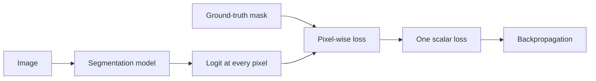

# Pixel logits in binary segmentation

## What "one logit per pixel" means

In binary classification, the model produces one logit for the whole image:

```text
[B, 3, H, W] -> [B]
```

In binary semantic segmentation, the model must keep a spatial grid and produce one logit at every output position:

```text
[B, 3, H, W] -> [B, 1, H, W]
```

The `1` is the single output channel for the binary question:

> Is this spatial position defect or background?

The model does not manually loop over pixels and assign values one by one. A convolutional layer computes all spatial positions in parallel.

## The feature tensor before the final prediction

Suppose the final decoder stage produces:

```text
[B, 32, H, W]
```

At every spatial position `(i, j)` there are 32 learned feature values.

Conceptually, at one position we have a vector:

```text
[f1, f2, ..., f32]
```

Those values are not RGB anymore. They are learned features created by the previous encoder, bottleneck, decoder and skip-connection computations.

## Why a 1x1 convolution is useful

A common final layer for binary segmentation is:

```python
nn.Conv2d(32, 1, kernel_size=1)
```

Its weight tensor has shape:

```text
[1, 32, 1, 1]
```

So it learns one weight for each of the 32 input feature channels, plus a bias.

At each spatial position it computes a learned weighted combination of the 32 feature values:

```math
z_{b,i,j}
=
b
+
\sum_{c=1}^{C} w_c F_{b,c,i,j}
```

where:

- `F` is the final decoder feature tensor;
- `C` is the number of feature channels, for example 32;
- `w_c` is the learned weight for feature channel `c`;
- `b` is the learned bias;
- `z_{b,i,j}` is the defect logit at spatial position `(i,j)` for sample `b`.

The same learned weights are applied at every spatial position. This parameter sharing is the same convolution idea already studied in the CNN baseline.

## Numerical example for one position

Imagine that only three feature channels existed at one output position:

```text
features = [2.0, -1.0, 0.5]
weights  = [0.4, -0.2, 0.6]
bias     = -0.1
```

The final 1x1 convolution computes:

```text
logit = 2.0×0.4 + (-1.0)×(-0.2) + 0.5×0.6 - 0.1
      = 1.2
```

That number is the logit for that spatial position.

After sigmoid:

```text
sigmoid(1.2) ≈ 0.77
```

So this position receives a relatively high defect score.

During training, however, the model normally returns the raw logit and `BCEWithLogitsLoss` handles the sigmoid internally.

## Does one output logit depend only on one original RGB pixel?

No.

This is a crucial distinction.

The final `1x1` convolution looks only at the feature vector at one decoder position, but those features were created by many previous convolutions and therefore already contain context from a larger region of the original image.

The relevant idea is the **receptive field**: one deep feature can depend on many input pixels.

So the model is not doing:

> classify each RGB pixel independently.

It is closer to:

> for every output location, use the learned contextual representation associated with this location to decide whether it belongs to a defect.

U-Net skip connections also inject higher-resolution information into this representation, which helps preserve localization detail.

## How the spatial positions align with the mask

The decoder is designed to recover the target spatial resolution `H x W`.

Therefore the output:

```text
[B, 1, H, W]
```

has the same spatial size as the ground-truth mask:

```text
[B, 1, H, W]
```

The value at output position `(i,j)` is compared with the target mask value at `(i,j)`.

For binary masks:

```text
target = 0 -> background / clean pixel
target = 1 -> defect pixel
```

## Pixel-level loss

`BCEWithLogitsLoss` can operate directly on the two tensors with matching shapes:

```python
loss = criterion(logits, masks)
```

Conceptually, BCE is evaluated for every pixel position and then reduced, normally by averaging, into one scalar loss used for backpropagation.

So the training chain becomes:



## From logits to a predicted mask

For evaluation or inference:

```python
scores = torch.sigmoid(logits)
predicted_mask = scores >= threshold
```

This happens element-wise, so every spatial position receives its own score and binary decision.

A threshold such as `0.5` is a decision rule, not part of the model's learned parameters.

## Binary versus multi-class segmentation

Our current task is binary, so one output channel is enough:

```text
[B, 1, H, W]
```

For a multi-class problem with `K` mutually exclusive classes, a common output is:

```text
[B, K, H, W]
```

At every `(i,j)` there would then be `K` class logits rather than one binary logit.

## Mental model

A useful way to remember the final stage is:

> The decoder builds a feature vector for every spatial location. The final 1x1 convolution acts like the same small linear classifier applied to every location, converting its feature vector into a defect logit.

## Questions to be able to answer

1. Why does binary segmentation output `[B,1,H,W]` instead of `[B]`?
2. What information exists at one position of `[B,32,H,W]`?
3. What does `Conv2d(32,1,kernel_size=1)` learn?
4. Why does a 1x1 convolution not require manually iterating over pixels?
5. Does one output logit depend only on one original RGB pixel? Why not?
6. What is compared with the output logit at `(i,j)` during training?
7. Why do logits and ground-truth masks need compatible spatial shapes?
8. What changes between binary and multi-class segmentation outputs?
