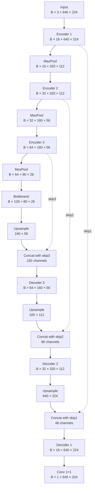

# Simple U-Net forward pass

This note records the first segmentation architecture implemented in M4.

The goal is educational: keep the network small enough to follow every tensor through the encoder, bottleneck, decoder and skip connections.

Implementation:

`src/industrial_vision/models/simple_unet.py`

## Architecture choices

The model uses:

- three encoder stages;
- `MaxPool2d(2)` for downsampling;
- one bottleneck block;
- bilinear interpolation for decoder upsampling;
- U-Net skip connections by channel concatenation;
- one final `1×1` convolution to produce one defect logit per pixel;
- no BatchNorm, dropout or pretrained encoder yet.

Each convolutional block contains two `3×3` convolutions with padding `1`, each followed by ReLU. These convolutions preserve `H` and `W` while changing the number of channels.

## Full tensor progression

For project images shaped `[B,3,640,224]`:

```text
input
[B, 3, 640,224]

encoder1
[B,16,640,224]   <- save skip1

MaxPool
[B,16,320,112]

encoder2
[B,32,320,112]   <- save skip2

MaxPool
[B,32,160, 56]

encoder3
[B,64,160, 56]   <- save skip3

MaxPool
[B,64, 80, 28]

bottleneck
[B,128,80,28]
```

At this point the decoder begins.

### Decoder stage 3

Upsample the bottleneck to the spatial size of `skip3`:

```text
[B,128,80,28]
        ↓ bilinear interpolation
[B,128,160,56]
```

Concatenate with:

```text
skip3 = [B,64,160,56]
```

along the channel dimension:

```text
[B,128,160,56]
+
[B, 64,160,56]

-> [B,192,160,56]
```

The decoder convolutional block converts this to:

```text
[B,64,160,56]
```

### Decoder stage 2

Upsample to the spatial size of `skip2`:

```text
[B,64,160,56]
        ↓
[B,64,320,112]
```

Concatenate with:

```text
skip2 = [B,32,320,112]
```

so channels become:

```text
64 + 32 = 96
```

The concatenated tensor is:

```text
[B,96,320,112]
```

and the decoder block returns:

```text
[B,32,320,112]
```

### Decoder stage 1

Upsample to the spatial size of `skip1`:

```text
[B,32,320,112]
        ↓
[B,32,640,224]
```

Concatenate with:

```text
skip1 = [B,16,640,224]
```

which gives:

```text
[B,48,640,224]
```

The final decoder block returns:

```text
[B,16,640,224]
```

## Final pixel classifier

The last layer is:

```python
nn.Conv2d(16, 1, kernel_size=1)
```

It converts the 16 feature values at every spatial position into one defect logit:

```text
[B,16,640,224]
        ↓ Conv 1×1
[B, 1,640,224]
```

The output therefore has the same spatial resolution as the target mask.

No sigmoid is applied inside the model. Training losses such as `BCEWithLogitsLoss` should receive the raw logits directly.

## Architecture diagram



## Why the skips are saved before pooling

The skip connection exists to preserve higher-resolution information.

For example, `encoder3` produces `[B,64,160,56]`. If we saved only the tensor after pooling, it would already be `[B,64,80,28]` and would no longer provide the higher-resolution representation needed by the decoder at `160×56`.

So each skip is captured before that stage is downsampled.

## Why concatenation increases channels

Concatenation does not average or overwrite the two tensors.

If the decoder has `128` channels and the skip has `64` channels at the same `H×W`, concatenating along channel dimension gives `192` channels.

The following convolutional block learns how to combine those two information sources and usually reduces the channel count again.

## What is learned and what is fixed?

Learned:

- all convolution weights in encoder blocks;
- bottleneck convolution weights;
- decoder convolution weights;
- final `1×1` pixel-classifier weights.

Fixed operation with no learned weights:

- MaxPool;
- bilinear interpolation;
- tensor concatenation.

## Questions to be able to answer

1. Why is `skip1` saved before the first pooling operation?
2. Why does bilinear upsampling change `H` and `W` but not channel count?
3. Why does concatenating `128` decoder channels with `64` skip channels produce `192` channels?
4. Which operation reduces those `192` channels back to `64`?
5. Why does the final `1×1` convolution output `[B,1,H,W]`?
6. Which operations in this U-Net contain learned parameters and which do not?
7. Why does the model return logits rather than applying sigmoid itself?
