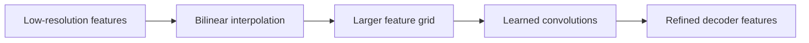

# Upsampling in a segmentation decoder

## What kind of thing is upsampling?

Upsampling is an **operation that increases spatial resolution**.

It is not a complete network and it is not the same thing as a decoder.

A decoder is a subnetwork made from several operations and layers. Upsampling is one operation the decoder can use.

Example:

```text
[B, 128, 80, 28]
        ↓ upsample ×2
[B, 128,160, 56]
```

The goal is to make the spatial grid larger again after the encoder reduced it.

## Why segmentation needs upsampling

An encoder often performs downsampling:

```text
640×224
↓
320×112
↓
160×56
↓
80×28
```

But a pixel-aligned segmentation mask must eventually return to the target resolution:

```text
640×224
```

So the decoder needs a mechanism for increasing `H` and `W`.

## Why upsampling is not the exact inverse of downsampling

Downsampling often merges several values into fewer spatial positions.

For example, average pooling could map a `2×2` patch:

```text
2  4
6  8
```

to one value:

```text
(2 + 4 + 6 + 8) / 4 = 5
```

Once only `5` remains, the original four values cannot be reconstructed uniquely. Many different `2×2` patches have the same average.

So when we make a grid larger again, we are not truly undoing pooling. We must **estimate or create new positions from the values that remain**.

That is what interpolation does.

## Nearest-neighbor interpolation

Nearest-neighbor interpolation is the simplest idea.

When a new output position is created, it copies the value of the nearest existing position.

For a simple `2×2` grid:

```text
1  2
3  4
```

upsampling by a factor of 2 with nearest neighbor gives conceptually:

```text
1  1  2  2
1  1  2  2
3  3  4  4
3  3  4  4
```

No new intermediate numerical values are invented. Existing values are repeated.

Nearest-neighbor interpolation is especially useful for **discrete label masks**. If a ground-truth mask contains only `0` and `1`, nearest-neighbor resizing preserves those labels instead of creating artificial values such as `0.37`.

## Bilinear interpolation

Bilinear interpolation is smoother.

Instead of simply copying the nearest value, a new position is estimated from the surrounding values, with closer neighbors contributing more.

First consider the one-dimensional idea. If two known values are:

```text
0 ---------------- 10
```

then a point exactly halfway between them can be estimated as:

```text
5
```

A point one quarter of the way from `0` to `10` would be:

```text
2.5
```

Bilinear interpolation applies the same idea in two spatial dimensions. A new point inside a rectangle is computed from the four surrounding grid values using distance-dependent weighted averages.

For feature maps, this produces a smoother enlarged grid than nearest neighbor.

Important: those interpolated values are **estimates**, not recovered original information.

## Why use interpolation inside a decoder?

Suppose a decoder feature map is:

```text
[B, 128, 80, 28]
```

Bilinear interpolation can enlarge it to:

```text
[B, 128, 160, 56]
```

without learning any parameters.

Then ordinary convolutions can process the larger feature map and learn how to refine it.

Conceptually:



This separation is useful for learning:

- interpolation decides **where to create the larger grid values** using a fixed rule;
- following convolutions contain trainable weights and learn how to transform/refine the enlarged features.

## Interpolation for images/features vs masks

This distinction matters in the project.

For continuous image values or neural-network feature maps, bilinear interpolation is often appropriate because intermediate values make sense.

For a binary ground-truth mask, labels are categorical:

```text
0 = background
1 = defect
```

Using bilinear interpolation could invent values between the classes near a boundary. That is why our dataset preprocessing uses nearest-neighbor resizing for masks.

## Important limitation

Upsampling increases the number of spatial positions, but it does **not automatically recover information that was lost during downsampling**.

If a small boundary disappeared in the encoder, simply making the tensor larger does not tell the network exactly where that boundary was.

This is one reason U-Net also uses skip connections from higher-resolution encoder stages.

## Common ways to upsample

### 1. Interpolation followed by convolution

A simple approach is:

```text
low-resolution features
↓ interpolation
larger feature grid
↓ convolution
refined features
```

Interpolation itself has no learned parameters.

### 2. Transposed convolution

A transposed convolution is a learnable operation that can increase spatial resolution.

It is called `ConvTranspose2d` in PyTorch.

Unlike simple interpolation, its transformation contains trainable weights.

It is not literally the mathematical inverse of a normal convolution, despite the common informal phrase "deconvolution".

We will study its mechanics only if/when the project actually uses it.

## Which approach will this project start with?

For the first educational segmentation baseline, the implementation should prefer the simplest option that keeps tensor shapes explicit and understandable.

A likely choice is bilinear interpolation followed by normal convolutions, because it cleanly separates the fixed resizing operation from the learned feature refinement.

The final implementation choice should still be made when the first U-Net is written.

## How upsampling and skip connections work together

Suppose the decoder currently has:

```text
[B,128,80,28]
```

After upsampling:

```text
[B,64,160,56]
```

and the corresponding encoder stage saved a feature map shaped:

```text
[B,64,160,56]
```

Now both have the same `H` and `W`, so U-Net can combine them, commonly by concatenating channels:

```text
decoder [B,64,160,56]
encoder [B,64,160,56]
            ↓ concatenate
         [B,128,160,56]
```

Following convolutions learn how to combine the deep decoder context with the higher-resolution encoder detail.

## Mental model

- downsampling: compress several spatial positions into fewer positions;
- information lost during that compression cannot be uniquely reconstructed;
- interpolation: create a larger grid by estimating values from existing positions;
- nearest neighbor: copy nearest values;
- bilinear: weighted average of surrounding values;
- skip connection: bring back higher-resolution information from before stronger compression;
- convolution after combining features: learn how to use that information.

## Questions to be able to answer

1. Is upsampling a layer, a subnetwork or a complete architecture?
2. Why is upsampling not the exact inverse of pooling/downsampling?
3. What does nearest-neighbor interpolation do?
4. What does bilinear interpolation do conceptually?
5. Why can bilinear interpolation create values that were not present in the original grid?
6. Why is nearest neighbor preferable for binary ground-truth masks?
7. Why does a segmentation decoder need to increase `H` and `W`?
8. Why does making a tensor larger not automatically restore lost details?
9. What is the difference between interpolation and a transposed convolution?
10. Why do U-Net skips connect stages with matching spatial resolution?
