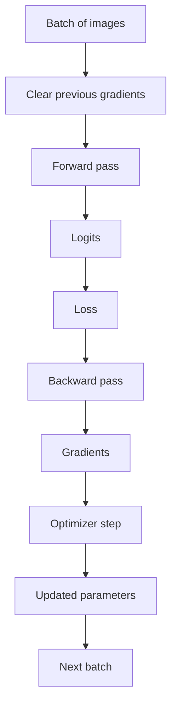

# Training — study index

These notes cover the part of the project that turns a forward pass and a scalar loss into learning, then extends that understanding to reliable GPU execution.

## Suggested reading order

1. [Gradients and backpropagation](topics/gradients-and-backpropagation.md) — what a gradient means, chain rule, `loss.backward()` and the boundary between gradient computation and parameter updates.
2. [Batches and epochs](topics/batches-and-epochs.md) — sample, batch, iteration/step and epoch.
3. [Optimizer and gradient reset](topics/optimizer-and-gradient-reset.md) — gradient accumulation, `optimizer.zero_grad()`, `optimizer.step()`, learning rate and the one-batch training step.
4. [Training mode vs evaluation mode](topics/train-vs-eval.md) — `model.train()`, `model.eval()`, `torch.no_grad()` and why validation must not update parameters.
5. [Training and validation loop](topics/training-validation-loop.md) — epoch-level loss, imbalanced classification metrics and best-checkpoint selection.
6. [Classification metrics](topics/classification-metrics.md) — TP/TN/FP/FN, accuracy, precision, recall and F1 for imbalanced defect detection.
7. [Class imbalance and positive weighting](topics/class-imbalance-and-pos-weight.md) — why EXP-001 collapsed to the majority class and how `pos_weight` changes BCE training.
8. [Classification threshold](topics/classification-threshold.md) — how a probability becomes a class decision and why threshold choice trades precision against recall.
9. [Error analysis](topics/error-analysis.md) — inspect FP/FN examples, score overlap and defect size before choosing the next model change.
10. [GPU runtime, CUDA OOM, smoke tests and BatchNorm constraints](topics/gpu-runtime-smoke-tests-and-batchnorm.md) — GPU vs CUDA, VRAM, smoke tests, singleton BatchNorm failure and why EXP-014 uses `drop_last=True` for training.
11. [Checkpoints and resumable training](topics/checkpoints-and-resuming.md) — best versus latest checkpoints, optimizer/RNG state and how to recover interrupted GPU experiments.

## Training boundary

The important separation is:

- the loss measures prediction error;
- backpropagation computes gradients;
- the optimizer uses gradients to update parameters;
- gradients are cleared before the next standard training step so batches do not unintentionally accumulate into one another;
- validation observes the model without updating it;
- epoch metrics summarize behavior over all samples rather than one batch;
- runtime checks such as smoke tests verify that the whole pipeline is operational before committing to expensive training;
- best checkpoints support model selection, while latest checkpoints support interruption recovery.

## Current implementation

Reusable classification train/validation logic:

`src/industrial_vision/training/classification.py`

Reusable segmentation train/validation logic:

`src/industrial_vision/training/segmentation.py`

Classification baseline training:

`scripts/train_baseline.py`

SimpleUNet segmentation training:

`scripts/train_simple_unet.py`

DeepLabV3 segmentation training:

`scripts/train_deeplabv3.py`

The DeepLab script supports `--latest-checkpoint` and `--resume` so a remote GPU interruption does not require starting a long experiment from zero.

Remote GPU workflow:

`notebooks/colab/remote_training.ipynb`

The Colab notebook stages KSDD2 onto ephemeral local storage, runs tests and smoke tests, executes training through the repository scripts and persists logs/checkpoints/figures to Google Drive.

## Interactive visual

A small gradient-descent visualization is available at:

`docs/learning/visuals/gradient-descent-demo.html`
