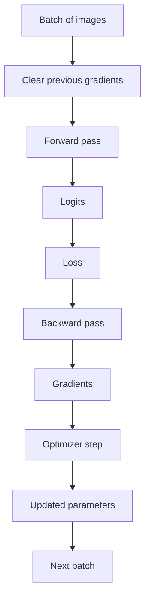

# Training — study index

These notes cover the part of M2 that turns a forward pass and a scalar loss into learning.

## Suggested reading order

1. [Gradients and backpropagation](topics/gradients-and-backpropagation.md) — what a gradient means, chain rule, `loss.backward()` and the boundary between gradient computation and parameter updates.
2. [Batches and epochs](topics/batches-and-epochs.md) — sample, batch, iteration/step and epoch.
3. [Optimizer and gradient reset](topics/optimizer-and-gradient-reset.md) — gradient accumulation, `optimizer.zero_grad()`, `optimizer.step()`, learning rate and the one-batch training step.
4. [Training mode vs evaluation mode](topics/train-vs-eval.md) — `model.train()`, `model.eval()`, `torch.no_grad()` and why validation must not update parameters.
5. [Training and validation loop](topics/training-validation-loop.md) — epoch-level loss, imbalanced classification metrics and best-checkpoint selection.
6. [Classification metrics](topics/classification-metrics.md) — TP/TN/FP/FN, accuracy, precision, recall and F1 for imbalanced defect detection.
7. [Class imbalance and positive weighting](topics/class-imbalance-and-pos-weight.md) — why EXP-001 collapsed to the majority class and how `pos_weight` changes BCE training.

## Training boundary

The important separation is:

- the loss measures prediction error;
- backpropagation computes gradients;
- the optimizer uses gradients to update parameters;
- gradients are cleared before the next standard training step so batches do not unintentionally accumulate into one another;
- validation observes the model without updating it;
- epoch metrics summarize behavior over all samples rather than one batch.

## Current M2 implementation

Reusable train/validation epoch logic:

`src/industrial_vision/training/classification.py`

Executable baseline training script:

`scripts/train_baseline.py`

The script reports loss, accuracy, precision, recall, F1 and TP/TN/FP/FN. By default it uses unweighted `BCEWithLogitsLoss()`; `--pos-weight` enables an explicitly weighted positive class for controlled imbalance experiments. The best checkpoint is selected by validation loss.

## Interactive visual

A small gradient-descent visualization is available at:

`docs/learning/visuals/gradient-descent-demo.html`
