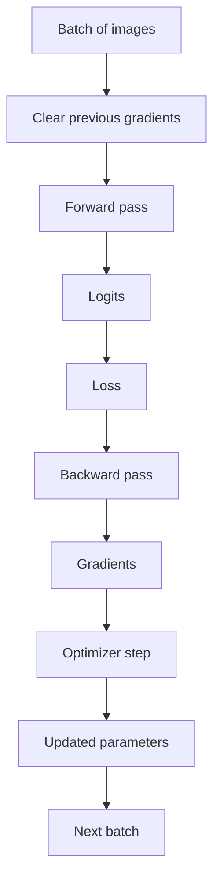

# Training — study index

These notes cover the part of M2 that turns a forward pass and a scalar loss into learning.

## Suggested reading order

1. [Gradients and backpropagation](topics/gradients-and-backpropagation.md) — what a gradient means, chain rule, `loss.backward()` and the boundary between gradient computation and parameter updates.
2. [Batches and epochs](topics/batches-and-epochs.md) — sample, batch, iteration/step and epoch.
3. [Optimizer and gradient reset](topics/optimizer-and-gradient-reset.md) — gradient accumulation, `optimizer.zero_grad()`, `optimizer.step()`, learning rate and the one-batch training step.

The next topic will be added after it is studied and understood: the complete training/validation loop and the distinction between training and evaluation mode.

## Training boundary

The important separation is:

- the loss measures prediction error;
- backpropagation computes gradients;
- the optimizer uses gradients to update parameters;
- gradients are cleared before the next standard training step so batches do not unintentionally accumulate into one another.

## Interactive visual

A small gradient-descent visualization is available at:

`docs/learning/visuals/gradient-descent-demo.html`
