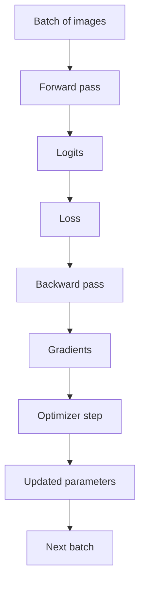

# Training — study index

These notes cover the part of M2 that turns a forward pass and a scalar loss into learning.

## Suggested reading order

1. [Gradients and backpropagation](topics/gradients-and-backpropagation.md) — what a gradient means, chain rule, `loss.backward()` and the boundary between gradient computation and parameter updates.
2. [Batches and epochs](topics/batches-and-epochs.md) — sample, batch, iteration/step and epoch.

The next topics will be added only after they are studied and understood, especially optimizer behavior, gradient accumulation and the complete training loop.

## Training boundary

The important separation is:

- the loss measures prediction error;
- backpropagation computes gradients;
- the optimizer uses gradients to update parameters.

## Interactive visual

A small gradient-descent visualization is available at:

`docs/learning/visuals/gradient-descent-demo.html`
