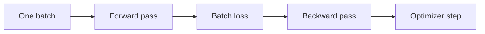
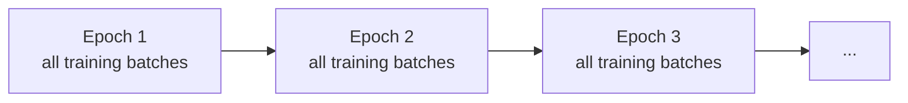

# Batches, iterations and epochs

These terms describe **how training data is consumed over time**. They are different levels of the same training process.

## Sample

A sample is one training example: in this project, one image together with its label and associated data.

## Batch

A batch is a group of samples processed together by the model.

If `batch_size = 32`, one training iteration receives up to 32 images at once.

For a normal training batch, the sequence is:



After that optimizer step, training moves to the next batch.

## Iteration / training step

One **iteration** or **training step** usually means processing one training batch and performing one parameter update.

So, in the usual loop:

```text
1 batch processed ≈ 1 training step ≈ 1 optimizer update
```

This equivalence can change with techniques such as gradient accumulation, but we have not introduced that yet.

## Epoch

An **epoch** is completed when the model has gone through the entire training dataset once.

Therefore:

```text
batch ≠ epoch
```

An epoch contains many batches.

If a training dataset contains `N` samples and the batch size is `B`, the approximate number of batches per epoch is:

```math
\text{batches per epoch}=\left\lceil\frac{N}{B}\right\rceil
```

The ceiling is needed because the final batch may contain fewer than `B` samples.

Example: with `1000` training images and `batch_size = 32`:

```math
\left\lceil\frac{1000}{32}\right\rceil=32
```

So one epoch contains 32 training batches. Only after those 32 batches have been processed has the model seen the whole training set once.

## Multiple epochs

Training usually repeats this full pass several times:



The model parameters are **not reset** between epochs. Epoch 2 starts with the parameters learned at the end of epoch 1.

This repeated exposure lets the optimizer continue improving the parameters.

## Shuffling

For training, the samples are commonly shuffled before each epoch. The dataset is the same, but the grouping and order of examples can change.

This helps avoid learning artifacts caused by a fixed sample order.

Validation is different: we evaluate the model on validation batches, but we do not perform `backward()` or optimizer updates.

## Mental hierarchy

```text
dataset
└── epoch = one complete pass through the training dataset
    ├── batch 1 = one training step
    ├── batch 2 = one training step
    ├── batch 3 = one training step
    └── ...
```

This tree is intentionally kept as text because it represents hierarchy rather than a geometric mechanism.

## Questions to be able to answer

1. What is the difference between a sample and a batch?
2. Is one batch one epoch?
3. When is an epoch complete?
4. What is an iteration or training step?
5. How many optimizer updates normally occur during one epoch?
6. Why can the final batch be smaller?
7. Are the model weights reset between epochs?
8. Why is training data commonly shuffled each epoch?
9. Why do validation batches not update parameters?
