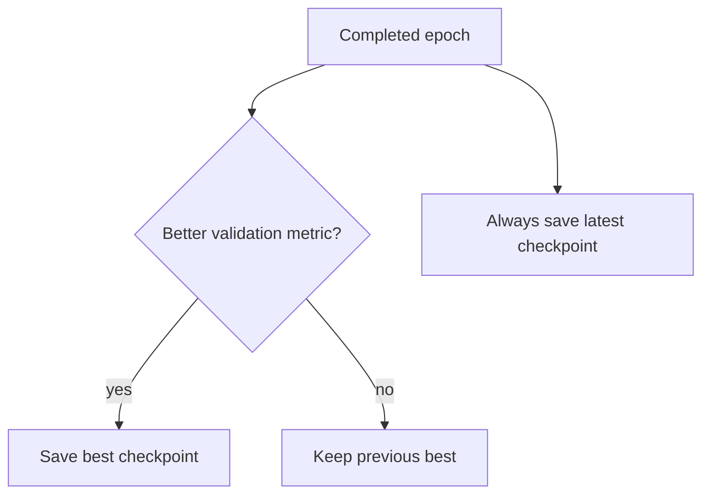

# Checkpoints and resumable training

## Why checkpoints matter

Training can stop for reasons unrelated to the model:

- Colab disconnects;
- the runtime is reclaimed;
- a machine reboots;
- a process is interrupted;
- a long job hits an infrastructure limit.

If the only saved file is the final model, all progress since the last completed run can be lost.

A checkpoint makes training state persistent.

---

## A model checkpoint is more than model weights

To evaluate a model, the minimum useful state is usually:

```text
model_state_dict
```

To **resume training**, we also need optimizer state:

```text
model_state_dict
optimizer_state_dict
current epoch
```

For stronger reproducibility we may also save:

```text
best validation metrics so far
DataLoader generator state
PyTorch RNG state
CUDA RNG state
training configuration
preprocessing configuration
```

Why?

Because resuming the model weights alone restores the learned function but not necessarily the exact optimization trajectory.

---

## Best checkpoint versus latest checkpoint

These solve different problems.

### Best checkpoint

Selected by a validation criterion such as:

```text
lowest val loss
highest val Dice
```

Purpose:

> keep the model state we would choose for evaluation/deployment.

### Latest checkpoint

Overwritten after every completed epoch.

Purpose:

> recover as much training progress as possible after interruption.

They should not be confused.



The latest model can be worse than the best model. That is fine: its role is recovery, not model selection.

---

## Why optimizer state matters

Adam does not update parameters using only the current gradient.

It maintains moving statistics for each parameter.

If we restore model weights but recreate Adam from scratch:

```text
weights restored
optimizer history lost
```

Training can continue, but it is not the same optimization state.

Therefore resumable training should restore:

```python
optimizer.load_state_dict(checkpoint["optimizer_state_dict"])
```

---

## Why RNG state matters

Training can contain randomness from:

- shuffled batches;
- dropout;
- augmentations;
- random sampling;
- CUDA operations.

If we resume from the same model and optimizer but generate a different future batch order, the trajectory can diverge.

For this reason our DeepLab latest checkpoints now record:

```text
data_loader_generator_state
torch_rng_state
cuda_rng_state_all
```

This does not promise bitwise reproducibility across every hardware/software configuration, but it makes same-environment continuation substantially more controlled.

---

## The EXP-014 interruption

The first real EXP-014 Colab run reached epoch 7 and then the external runtime stopped. The persisted log contained no Python traceback.

At that moment the training script saved only best-loss and best-Dice checkpoints, not a latest checkpoint after every epoch.

The best persisted model was epoch 5:

```text
val loss = 0.1922
val Dice = 0.4634
```

Therefore recovery starts from epoch 5 and repeats epochs 6 onward.

Because that older checkpoint predates RNG-state persistence, this recovery preserves:

- model state;
- Adam optimizer state;
- training configuration;

but cannot perfectly restore the exact random state that existed immediately after epoch 5.

This is documented rather than hidden.

After this incident, DeepLab training adds:

```text
--latest-checkpoint
--resume
```

so future interruptions can restart from the last completed epoch.

---

## What `--epochs` means when resuming

In our script, `--epochs` means the **total target epoch count**, not “number of extra epochs”.

Example:

```text
checkpoint epoch = 8
--epochs 20
```

means:

```text
resume at epoch 9
train through epoch 20
```

not 20 additional epochs.

---

## Compatibility checks

A resume checkpoint should belong to the same experiment configuration.

Our DeepLab script checks important fields such as:

- model name;
- batch size;
- learning rate;
- threshold;
- seed;
- loss mode;
- ImageNet normalization;
- `drop_last` policy.

A mismatched checkpoint raises an error instead of silently continuing a different experiment under the same name.

---

## Common mistakes

- Saving only model weights and assuming exact training can resume.
- Using the best checkpoint as if it were necessarily the latest epoch.
- Resetting Adam state accidentally during resume.
- Changing hyperparameters while calling the run a continuation of the same experiment.
- Overwriting the original log when resuming, losing evidence of the interruption.
- Claiming exact reproducibility when the old checkpoint did not preserve RNG state.

---

## Interview explanation

> I keep two checkpoint concepts separate: best checkpoints for model selection and a latest checkpoint for fault recovery. To resume training reliably I restore both the model and optimizer states, keep the original experiment configuration, and persist RNG/DataLoader state when possible. This became concrete in my project when a Colab run stopped after epoch 7; the incident motivated adding an every-epoch latest checkpoint and explicit resume support.

## Questions to be able to answer

1. Why is `model_state_dict` alone insufficient for exact Adam continuation?
2. What is the difference between best and latest checkpoints?
3. Why save RNG state?
4. What should happen if resume hyperparameters do not match the checkpoint?
5. Why did the interrupted EXP-014 have to restart from epoch 5 instead of epoch 7?
