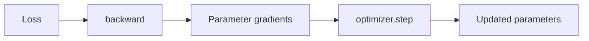

# Gradients and backpropagation

This note starts after the model has already produced a scalar loss. The question is now: **how do we know how each trainable parameter should change to reduce that loss?**

## Gradient intuition with one parameter

Start with one weight `w` and a simple loss:

```math
L(w) = (w-3)^2
```

The minimum is at `w = 3`.

The derivative is:

```math
\frac{dL}{dw} = 2(w-3)
```

At `w = 1`:

```math
\frac{dL}{dw} = -4
```

The negative sign means that increasing `w` locally decreases the loss. At `w = 5`, the gradient is positive, so increasing `w` would increase the loss.

A useful interpretation is:

> The gradient tells us how sensitive the loss is to a small change in a parameter, including the local direction in which the loss increases.

Gradient descent therefore moves in the opposite direction:

```math
w_{\mathrm{new}}
=
w_{\mathrm{old}}-\eta\frac{dL}{dw}
```

where `η` is the learning rate.

For `w = 1`, gradient `-4` and learning rate `0.1`:

```math
w_{\mathrm{new}} = 1 - 0.1(-4) = 1.4
```

The parameter moves toward the minimum at `3`.

The interactive visualization for this example is:

`docs/learning/visuals/gradient-descent-demo.html`

## From one parameter to a neural network

Our CNN has many trainable parameters. For each one, training needs a derivative such as:

```math
\frac{\partial L}{\partial w_i}
```

The collection of these partial derivatives is the gradient with respect to the model parameters.

Each value answers a local question:

> If this parameter changes slightly while the others are considered fixed for this derivative, how does the loss change?

## Why backpropagation is needed

A parameter in an early convolution does not affect the loss directly. It affects an intermediate value, which affects another activation, which eventually affects the logit and the loss.

The chain rule connects those dependencies. If:

```text
w → z → L
```

then:

```math
\frac{\partial L}{\partial w}
=
\frac{\partial L}{\partial z}
\frac{\partial z}{\partial w}
```

A deep neural network contains a much longer chain, but the principle is the same.

## What backpropagation actually does

Backpropagation is the efficient procedure used to propagate derivatives backward through the computational graph using the chain rule.

In PyTorch:

```python
loss.backward()
```

computes gradients for parameters that require them.

For example, after the backward pass, a convolutional weight tensor has a corresponding `.grad` tensor with the same shape.

Important boundary:



`loss.backward()` **does not update the weights**. It computes the gradients. The optimizer performs the update later.

## Connection with BCEWithLogitsLoss

For one binary example, an important result is:

```math
\frac{\partial L}{\partial z} = \sigma(z)-y
```

where `z` is the logit and `y` is the true binary label.

If `y = 1` and the predicted defect probability is `0.2`, then:

```math
\frac{\partial L}{\partial z} = 0.2-1=-0.8
```

The negative gradient means gradient descent tends to increase the logit, which is consistent with needing a higher defect probability.

If `y = 0` and the predicted defect probability is `0.9`, then:

```math
\frac{\partial L}{\partial z} = 0.9-0=0.9
```

Gradient descent tends to decrease the logit.

## Concepts not yet opened fully

We have not yet studied:

- why PyTorch gradients accumulate by default;
- why `optimizer.zero_grad()` is needed;
- how Adam differs from basic gradient descent;
- learning-rate choice;
- the complete training loop.

Those should be added only when studied rather than treated as already understood.

## Questions to be able to answer

1. What does a gradient tell us about a parameter?
2. Why does gradient descent move opposite to the gradient?
3. What role does the learning rate play?
4. Why does an early CNN weight influence the final loss?
5. What does the chain rule provide?
6. What does backpropagation compute?
7. Does `loss.backward()` update model weights?
8. What component actually updates parameters?
