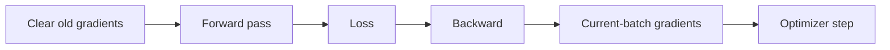

# Optimizer and gradient reset

This note continues after `loss.backward()` has computed gradients for the trainable parameters.

The two remaining operations in one training step are:

```python
optimizer.zero_grad()
optimizer.step()
```

They do different jobs.

## Why `optimizer.zero_grad()` is needed

After:

```python
loss.backward()
```

PyTorch stores a gradient in each trainable parameter's `.grad` attribute.

By default, a later backward pass **adds** new gradients to the existing values instead of replacing them.

For one parameter `w`, suppose the first batch produces gradient `g_1`.

After the first backward pass:

```math
w.\mathrm{grad} = g_1
```

If we process a second batch and call `backward()` again without clearing gradients, and that batch produces gradient `g_2`, PyTorch accumulates:

```math
w.\mathrm{grad} = g_1 + g_2
```

For the usual training loop, each optimizer update should use the gradients of the current batch only. Therefore we clear the previous gradients before computing the next ones:

```python
optimizer.zero_grad()
```

Conceptually, each batch normally follows:



Gradient accumulation is not a bug; it is useful when we deliberately want to combine gradients across several backward passes. For our first baseline, however, we want the standard one-update-per-batch behavior.

## What `optimizer.step()` does

`loss.backward()` computes gradients but does not change parameters.

`optimizer.step()` reads the gradients stored in the parameters and applies the optimizer's update rule.

For plain stochastic gradient descent, the basic update is:

```math
\theta_{\mathrm{new}}
=
\theta_{\mathrm{old}}
-
\eta\nabla_{\theta}L
```

where:

- `θ` represents the model parameters;
- `η` is the learning rate;
- `∇_θ L` is the gradient of the loss with respect to those parameters.

So the separation is:

- `loss.backward()` → calculate gradients;
- `optimizer.step()` → use those gradients to update parameters.

## What is the optimizer?

An optimizer is the algorithm that decides how to turn gradients into parameter updates.

Basic gradient descent uses the gradient directly. Other optimizers modify that rule using additional information.

For the M2 baseline we will use Adam as a simple practical default:

```python
optimizer = torch.optim.Adam(model.parameters(), lr=1e-3)
```

`model.parameters()` gives the optimizer the trainable parameters it is allowed to update.

`lr=1e-3` sets the learning rate.

Adam keeps running statistics of past gradients and adapts update sizes per parameter. We do not need its full derivation before writing the baseline training loop; the important boundary is that Adam still consumes gradients produced by backpropagation and then updates the parameters.

Choosing Adam here is a baseline decision, not a claim that Adam is universally best.

## One complete training step

For one batch, the core sequence is:

```python
optimizer.zero_grad()
logits = model(images)
loss = criterion(logits, labels)
loss.backward()
optimizer.step()
```

Each line has one specific responsibility:

1. `zero_grad()` clears gradients left by the previous update.
2. `model(images)` runs the forward pass and produces logits.
3. `criterion(...)` measures prediction error.
4. `backward()` computes gradients for the parameters.
5. `step()` updates the parameters using those gradients.

The order matters. In particular, `optimizer.step()` must happen after gradients have been computed.

## Batch and epoch connection

The sequence above normally happens once per training batch.

An epoch is complete only after all training batches have been processed once.

Therefore the structure is conceptually:

```python
for epoch in range(num_epochs):
    for images, masks, labels in train_loader:
        optimizer.zero_grad()
        logits = model(images)
        loss = criterion(logits, labels)
        loss.backward()
        optimizer.step()
```

The outer loop counts epochs. The inner loop processes batches.

## Questions to be able to answer

1. Where are gradients stored after `loss.backward()`?
2. Why do gradients accumulate in PyTorch?
3. What would happen if we never called `optimizer.zero_grad()` in the standard loop?
4. Does `optimizer.zero_grad()` change the model weights?
5. Does `loss.backward()` change the model weights?
6. What does `optimizer.step()` do?
7. What role does the learning rate play?
8. What does `model.parameters()` provide to the optimizer?
9. Why can Adam be used without changing how backpropagation computes gradients?
10. How many times is the core training step normally executed in one epoch?
