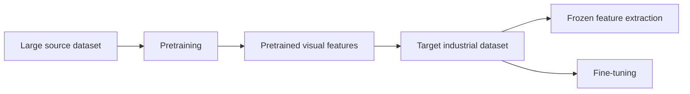

# Transfer learning

This section records the concepts used from M3 onward, where scratch models are compared with pretrained visual representations and later reused for semantic segmentation.

## Reading order

1. [Pretraining and freezing](topics/pretraining-and-freezing.md)
2. [Transfer learning versus fine-tuning](topics/transfer-learning-vs-fine-tuning.md)
3. [Fine-tuning](topics/fine-tuning.md)
4. [ImageNet normalization](topics/imagenet-normalization.md)
5. [ResNet18 and residual blocks](topics/resnet-and-residual-blocks.md)

For backbone terminology and the full ResNet family, see:

- [`../architectures/topics/backbones.md`](../architectures/topics/backbones.md)
- [`../architectures/topics/resnet-family.md`](../architectures/topics/resnet-family.md)

## Core mental model

A scratch model starts from random parameters and must learn useful visual features only from the project dataset.

Transfer learning starts from parameters learned on a previous visual task and reuses those representations for a new task.



The source task and target task do not need to have the same labels. What is transferred is mainly the learned representation encoded in the network weights.

The important distinction is:

```text
transfer learning = broad strategy of reusing prior learned knowledge
fine-tuning       = continue optimizing pretrained weights on the target data
```

Therefore a frozen pretrained backbone is already transfer learning even though it is not being fine-tuned.

## M3/M5 questions

We should be able to answer:

- What does a pretrained model actually contain?
- What is a backbone?
- Which parameters are reused and which are newly initialized?
- What does freezing a backbone change in backpropagation?
- What is the difference between feature extraction and fine-tuning?
- Can transfer learning happen without fine-tuning?
- Why can transfer learning help when the target dataset is relatively small?
- What is domain shift?
- Why can a smaller learning rate be appropriate during fine-tuning?
- How does a residual block differ from a plain stack of convolutions?
- Why must input preprocessing match the pretrained weight recipe?
- What exactly does ImageNet normalization do?
- How should transfer learning be compared fairly against a scratch baseline?

## Controlled comparison completed in M3

M3 compared three regimes on the same train/validation split and with the same classification metrics:

1. scratch CNN from M2;
2. pretrained ResNet18 with a frozen backbone;
3. pretrained ResNet18 with partial fine-tuning of `layer4`.

The frozen backbone did not outperform the scratch CNN, which showed that ImageNet features were not sufficiently aligned with the industrial domain when used unchanged.

Partial fine-tuning changed that result substantially. At matched validation recall `0.7347`:

| Model | Precision | TP | FP | FN |
|---|---:|---:|---:|---:|
| Frozen ResNet18 | 0.2416 | 36 | 113 | 13 |
| Scratch CNN, GAP+GMP | 0.5806 | 36 | 26 | 13 |
| **ResNet18 with `layer4` fine-tuned** | **0.9000** | **36** | **4** | **13** |

The best tested validation F1 of the fine-tuned model was `0.8090`.

## M5 extension

EXP-014 moves the same idea to semantic segmentation:

```text
pretrained DeepLabV3-ResNet50
        ↓
full model fine-tuning on KSDD2 masks
        ↓
binary defect segmentation
```

The model uses ImageNet-style input normalization because the pretrained weight recipe expects that numerical input convention.

## Main lesson

The important result is not simply that a larger network performs better.

The sequence of experiments teaches that:

- pretrained features can transfer useful visual information;
- source-domain features may be poorly aligned with a specialized industrial domain;
- freezing is a clean way to measure transferability before adaptation;
- fine-tuning can adapt the representation to the target domain;
- fine-tuning increases overfitting risk, so validation checkpoints remain essential;
- preprocessing is part of a pretrained model package and must stay consistent across training, validation and inference.

The project therefore treats transfer learning as an experimental strategy, not as an assumption that pretrained models must win.
