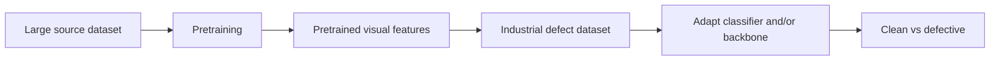

# Transfer learning

This section records the concepts used in M3, where the scratch CNN baseline is compared with a pretrained visual backbone.

## Reading order

1. [Pretraining and freezing](topics/pretraining-and-freezing.md)
2. [Fine-tuning](topics/fine-tuning.md)
3. [ResNet18 and residual blocks](topics/resnet-and-residual-blocks.md)

## Core mental model

A scratch model starts from random parameters and must learn useful visual features only from the project dataset.

Transfer learning starts from parameters learned on a previous visual task and reuses those representations for a new task.

The source task and target task do not need to have the same labels. What is transferred is mainly the learned representation encoded in the network weights.

## M3 questions

By the end of M3, we should be able to answer:

- What does a pretrained model actually contain?
- Which parameters are reused and which are newly initialized?
- What does freezing a backbone change in backpropagation?
- What is the difference between feature extraction and fine-tuning?
- Why can transfer learning help when the target dataset is relatively small?
- What is domain shift?
- Why can a smaller learning rate be appropriate during fine-tuning?
- How does a residual block differ from a plain stack of convolutions?
- How should transfer learning be compared fairly against the scratch baseline?

## Controlled comparison completed

M3 compared three regimes on the same train/validation split and with the same classification metrics:

1. scratch CNN from M2;
2. pretrained ResNet18 with a frozen backbone;
3. pretrained ResNet18 with partial fine-tuning of `layer4`.

The frozen backbone did not outperform the scratch CNN, which showed that ImageNet features were not sufficiently aligned with the industrial domain when used unchanged.

Partial fine-tuning changed that result substantially. At matched validation recall `0.7347`:

| Model | Precision | TP | FP | FN |
|---|---:|---:|---:|---:|
| Frozen ResNet18 | 0.2416 | 36 | 113 | 13 |
| Scratch CNN, GAP+GMP | 0.5806 | 36 | 26 | 13 |
| **ResNet18 with `layer4` fine-tuned** | **0.9000** | **36** | **4** | **13** |

The best tested validation F1 of the fine-tuned model was `0.8090`.

## Main M3 lesson

The important result is not simply that a larger network performed better.

The sequence of experiments showed:

- pretrained features can transfer useful visual information;
- source-domain features may be poorly aligned with a specialized industrial domain;
- freezing is a clean way to measure transferability before adaptation;
- partial fine-tuning can adapt deeper representations while preserving earlier generic features;
- fine-tuning also increases overfitting risk, so validation checkpoints remain essential.

In EXP-009, training approached perfect fit while validation loss worsened after the best checkpoint. This is why M3 stops at partial fine-tuning rather than automatically unfreezing more layers.

The next milestone moves from image-level classification to semantic segmentation, using the defect masks to learn where defects are located.
