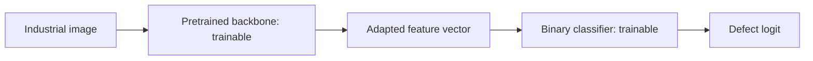
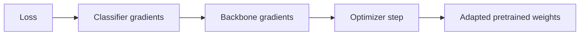

# Fine-tuning

## What fine-tuning is

Fine-tuning is the stage where a pretrained model is allowed to adapt its previously learned parameters to the target task.

The important point is that fine-tuning does not start from random weights.

It starts from pretrained weights and continues optimization using the target dataset.

Useful mental model:

> Pretraining gives the model a visual vocabulary. Fine-tuning adjusts that vocabulary to the target domain.

## Frozen feature extraction versus fine-tuning

### Frozen backbone


Only the new classifier changes.

### Fine-tuning



Now the target loss can also change the pretrained feature extractor.

## What happens during backpropagation?

Suppose a pretrained convolutional weight is called `w`.

When frozen:

```text
requires_grad = False
```

PyTorch does not optimize that parameter.

When unfrozen:

```text
requires_grad = True
```

backpropagation can compute a gradient for it and the optimizer can update it.

So the same chain we learned in M2 now reaches deeper into the network:



## Why not fine-tune everything immediately?

A pretrained model already contains useful structure. Large updates early in training can damage that representation before the new classifier has learned a sensible target mapping.

This is one reason a common workflow is:

1. replace the classifier;
2. train the new classifier while the backbone is frozen;
3. unfreeze part or all of the backbone;
4. continue training with a smaller learning rate.

This is not a universal rule, but it is a useful controlled strategy for our project.

## Full versus partial fine-tuning

Fine-tuning is not all-or-nothing.

### Full fine-tuning

All backbone parameters are trainable.

Advantages:

- maximum ability to adapt to the industrial domain;
- useful when domain shift is significant.

Risks:

- more trainable parameters;
- higher overfitting risk on a small dataset;
- larger updates can destroy useful pretrained features.

### Partial fine-tuning

Earlier layers remain frozen while later blocks are trainable.

Mental model:

```text
early layers
more general features
edges / contrast / simple textures
        ↓
later layers
more task-specific combinations
```

This motivates adapting later blocks first while preserving more general early representations.

The exact boundary is an experimental choice, not a law.

## Why use a smaller learning rate?

In the scratch CNN, every parameter starts untrained, so relatively large updates are expected.

In a pretrained backbone, the parameters already encode useful information. Fine-tuning usually aims to adjust them, not relearn them from zero.

Therefore the backbone often uses a smaller learning rate than a newly initialized classifier.

Conceptually:

```text
new classifier
needs large adaptation
→ larger learning rate can be reasonable

pretrained backbone
needs careful adjustment
→ smaller learning rate can be reasonable
```

PyTorch optimizer parameter groups let these two parts use different learning rates without needing separate optimizers.

## Catastrophic forgetting

If fine-tuning updates the pretrained weights too aggressively, the model can lose useful representations learned during pretraining.

This phenomenon is often described as catastrophic forgetting.

In our context, the practical warning is simple:

> Do not assume that making every layer trainable with the same large learning rate will automatically improve the model.

Fine-tuning needs to preserve useful source knowledge while adapting to the target domain.

## Fine-tuning and domain shift

Fine-tuning becomes especially valuable when frozen source features are useful but not sufficiently aligned with the target data.

Our domain contains narrow industrial surfaces and small localized defects, which differ strongly from ordinary natural-image classification.

If the frozen model plateaus, fine-tuning gives the feature extractor a chance to become more sensitive to industrial texture and defect patterns.

## BatchNorm nuance

Trainability and training mode are separate concerns.

A pretrained model can contain BatchNorm layers, which maintain running statistics in addition to trainable parameters.

Setting parameters to `requires_grad=False` freezes gradient-based parameter updates, but `model.train()` can still affect BatchNorm running statistics.

Therefore a robust freeze/fine-tune implementation must be explicit about both:

- which parameters are trainable;
- whether the model or selected modules are in training or evaluation mode.

For partial ResNet18 fine-tuning in this project, earlier residual stages stay in evaluation mode while `layer4` enters training mode. This means the earlier BatchNorm state remains fixed, while the deepest stage is allowed to adapt its trainable parameters and running statistics.

## Project evidence from EXP-008

The frozen ResNet18 experiment produced meaningful classification but did not beat the scratch CNN:

- frozen ResNet18 best tested validation F1: `0.6200`;
- scratch GAP+GMP best tested validation F1: `0.7013`.

At a similar recall near `0.63`, the scratch model also retained higher precision.

This is the evidence that justifies fine-tuning. The pretrained representation is useful enough to classify above chance, but not sufficiently aligned with KSDD2 when completely fixed.

## EXP-009 fine-tuning plan

The first adaptation step is deliberately partial:

- start from the trained frozen ResNet18 checkpoint;
- keep `conv1`, `layer1`, `layer2`, and `layer3` frozen;
- make `layer4` trainable;
- keep the binary classifier trainable;
- classifier learning rate: `1e-3`;
- `layer4` learning rate: `1e-4`;
- keep the same splits, `pos_weight=8.47`, metrics and threshold analysis.

The frozen checkpoint supplies the model weights, but a new optimizer is created because the set of trainable parameters has changed.

The question is not simply whether training loss decreases. The key question is whether adapting `layer4` improves the validation precision-recall trade-off compared with both frozen ResNet18 and the scratch CNN.

## How we will evaluate fine-tuning

The experiment should change as few variables as possible.

We will compare:

- scratch CNN baseline;
- frozen pretrained backbone;
- fine-tuned pretrained backbone.

Using the same target split and metrics:

- precision;
- recall;
- F1;
- TP / FP / FN;
- threshold sweep.

The key question is not merely whether validation loss decreases.

It is whether fine-tuning improves the precision-recall trade-off, especially whether we can detect more defects without producing an unacceptable number of false alarms.

## Interview explanation

A concise explanation is:

> Fine-tuning continues training from pretrained weights instead of random initialization. I first test the backbone as a frozen feature extractor, then unfreeze selected layers so the representation can adapt to the industrial domain. I use a conservative learning rate because the goal is to adjust useful pretrained features rather than overwrite them, and I compare the resulting precision-recall trade-off against both the frozen model and the scratch baseline.

## Questions to be able to answer

1. How is fine-tuning different from training from scratch?
2. How is fine-tuning different from frozen feature extraction?
3. What changes when `requires_grad` becomes `True` again?
4. Why might we unfreeze later layers before early layers?
5. Why can fine-tuning overfit more easily than a frozen backbone?
6. Why might the backbone use a smaller learning rate than the new classifier?
7. What is catastrophic forgetting in this context?
8. Why do BatchNorm layers make freezing slightly more subtle?
9. What evidence would justify moving from a frozen model to fine-tuning?
