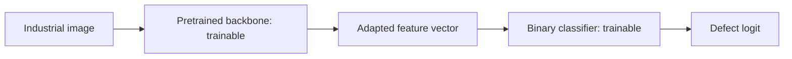
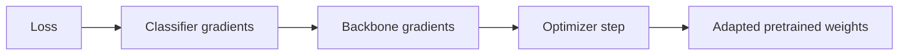

# Fine-tuning

## What fine-tuning is

Fine-tuning is the stage where a pretrained model is allowed to adapt its previously learned parameters to the target task.

The important point is that fine-tuning does not start from random weights.

It starts from pretrained weights and continues optimization using the target dataset.

Useful mental model:

> Pretraining gives the model a visual vocabulary. Fine-tuning adjusts that vocabulary to the target domain.

## Frozen feature extraction versus fine-tuning

### Frozen backbone


Only the new classifier changes.

### Fine-tuning



Now the target loss can also change the pretrained feature extractor.

## What happens during backpropagation?

Suppose a pretrained convolutional weight is called `w`.

When frozen:

```text
requires_grad = False
```

PyTorch does not optimize that parameter.

When unfrozen:

```text
requires_grad = True
```

backpropagation can compute a gradient for it and the optimizer can update it.

So the same chain we learned in M2 now reaches deeper into the network:



## Why not fine-tune everything immediately?

A pretrained model already contains useful structure. Large updates early in training can damage that representation before the new classifier has learned a sensible target mapping.

This is one reason a common workflow is:

1. replace the classifier;
2. train the new classifier while the backbone is frozen;
3. unfreeze part or all of the backbone;
4. continue training with a smaller learning rate.

This is not a universal rule, but it is a useful controlled strategy for our project.

## Full versus partial fine-tuning

Fine-tuning is not all-or-nothing.

### Full fine-tuning

All backbone parameters are trainable.

Advantages:

- maximum ability to adapt to the industrial domain;
- useful when domain shift is significant.

Risks:

- more trainable parameters;
- higher overfitting risk on a small dataset;
- larger updates can destroy useful pretrained features.

### Partial fine-tuning

Earlier layers remain frozen while later blocks are trainable.

Mental model:

```text
early layers
more general features
edges / contrast / simple textures
        ↓
later layers
more task-specific combinations
```

This motivates adapting later blocks first while preserving more general early representations.

The exact boundary is an experimental choice, not a law.

## Why use a smaller learning rate?

In the scratch CNN, every parameter starts untrained, so relatively large updates are expected.

In a pretrained backbone, the parameters already encode useful information. Fine-tuning usually aims to adjust them, not relearn them from zero.

Therefore the backbone often uses a smaller learning rate than a newly initialized classifier.

Conceptually:

```text
new classifier
needs large adaptation
→ larger learning rate can be reasonable

pretrained backbone
needs careful adjustment
→ smaller learning rate can be reasonable
```

PyTorch optimizer parameter groups let these two parts use different learning rates without needing separate optimizers.

For EXP-009 we used:

- classifier learning rate: `1e-3`;
- pretrained `layer4` learning rate: `1e-4`.

## Catastrophic forgetting

If fine-tuning updates the pretrained weights too aggressively, the model can lose useful representations learned during pretraining.

This phenomenon is often described as catastrophic forgetting.

In our context, the practical warning is simple:

> Do not assume that making every layer trainable with the same large learning rate will automatically improve the model.

Fine-tuning needs to preserve useful source knowledge while adapting to the target domain.

## Fine-tuning and domain shift

Fine-tuning becomes especially valuable when frozen source features are useful but not sufficiently aligned with the target data.

Our domain contains narrow industrial surfaces and small localized defects, which differ strongly from ordinary natural-image classification.

EXP-008 provided direct evidence of this domain shift: frozen ResNet18 features underperformed the scratch CNN.

EXP-009 then allowed only `layer4` and the classifier to adapt. At matched validation recall `0.7347`, the comparison was:

| Model | Precision | TP | FP | FN |
|---|---:|---:|---:|---:|
| Frozen ResNet18 | 0.2416 | 36 | 113 | 13 |
| Scratch CNN, GAP+GMP | 0.5806 | 36 | 26 | 13 |
| **ResNet18 with `layer4` fine-tuned** | **0.9000** | **36** | **4** | **13** |

All three models detect exactly the same number of validation defects in this comparison. The fine-tuned model is better because it achieves that recall with dramatically fewer false alarms.

This is strong project evidence for the purpose of fine-tuning: the source representation was useful as initialization, but its deeper features needed adaptation to separate industrial defects from normal texture.

## BatchNorm nuance

Trainability and training mode are separate concerns.

A pretrained model can contain BatchNorm layers, which maintain running statistics in addition to trainable parameters.

Setting parameters to `requires_grad=False` freezes gradient-based parameter updates, but `model.train()` can still affect BatchNorm running statistics.

Therefore a robust freeze/fine-tune implementation must be explicit about both:

- which parameters are trainable;
- whether the model or selected modules are in training or evaluation mode.

For partial ResNet18 fine-tuning in this project, earlier residual stages stay in evaluation mode while `layer4` enters training mode. This means the earlier BatchNorm state remains fixed, while the deepest stage is allowed to adapt its trainable parameters and running statistics.

## Overfitting evidence from EXP-009

Fine-tuning also increased the model's capacity to fit our small training set.

The best validation loss occurred at epoch 5:

```text
val_loss = 0.6126
```

After that, training continued improving until train F1 reached `0.9949` at epoch 10, while validation loss worsened to `1.2293`.

This is a clear example of overfitting:

> better training fit does not guarantee better generalization.

Our checkpoint policy protected us from keeping the final overfit state because it retained epoch 5, the epoch with the lowest validation loss.

## Project result

The saved EXP-009 checkpoint reached the following best tested validation operating point:

- threshold: `0.70`;
- precision: `0.9000`;
- recall: `0.7347`;
- F1: `0.8090`;
- TP: `36`;
- FP: `4`;
- FN: `13`.

The result demonstrates both sides of fine-tuning:

- it can adapt a useful pretrained representation to a shifted target domain;
- it can also overfit much faster because many more parameters become trainable.

## How we evaluate fine-tuning

The controlled comparison uses the same target split and metrics:

- precision;
- recall;
- F1;
- TP / FP / FN;
- threshold sweep.

The key question is not merely whether validation loss decreases.

It is whether fine-tuning improves the precision-recall trade-off, especially whether we can detect more defects without producing an unacceptable number of false alarms.

## Interview explanation

A concise explanation is:

> Fine-tuning continues training from pretrained weights instead of random initialization. I first tested ResNet18 as a frozen feature extractor, which underperformed my scratch CNN because of domain shift. I then unfroze only `layer4`, kept the earlier stages frozen, and used a smaller learning rate for the pretrained block than for the classifier. At the same validation recall of 0.7347, false positives dropped from 113 with the frozen backbone and 26 with the scratch CNN to only 4 after fine-tuning. This showed that pretrained features were useful, but their deeper representation needed adaptation to the industrial domain.

## Questions to be able to answer

1. How is fine-tuning different from training from scratch?
2. How is fine-tuning different from frozen feature extraction?
3. What changes when `requires_grad` becomes `True` again?
4. Why might we unfreeze later layers before early layers?
5. Why can fine-tuning overfit more easily than a frozen backbone?
6. Why might the backbone use a smaller learning rate than the new classifier?
7. What is catastrophic forgetting in this context?
8. Why do BatchNorm layers make freezing slightly more subtle?
9. What evidence from EXP-008 justified fine-tuning?
10. What evidence from EXP-009 shows that fine-tuning corrected part of the domain shift?
