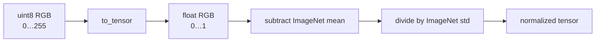

# ImageNet normalization

## What it is

ImageNet normalization is a fixed per-channel standardization commonly used with models pretrained on ImageNet-style pipelines.

After an RGB image has been converted to floating point values in `[0, 1]`, each channel is transformed as:

```math
x_{norm} = \frac{x - \mu}{\sigma}
```

Using the standard ImageNet channel statistics:

```text
mean = [0.485, 0.456, 0.406]
std  = [0.229, 0.224, 0.225]
```

for red, green and blue respectively.

In this repository:

```python
IMAGENET_MEAN = (0.485, 0.456, 0.406)
IMAGENET_STD = (0.229, 0.224, 0.225)
```

and DeepLabV3 enables:

```python
imagenet_normalize=True
```

---

## It is not the same as scaling to `[0, 1]`

`to_tensor()` already converts an 8-bit pixel such as `128` into approximately:

```text
128 / 255 ≈ 0.502
```

ImageNet normalization is an additional step.

For the red channel:

```text
(0.502 - 0.485) / 0.229 ≈ 0.074
```

So the pipeline is:



---

## Why pretrained models care

A pretrained network learned its filters while seeing inputs with a particular preprocessing convention.

If we reuse those weights but feed a very different numerical distribution, the first layers no longer receive the type of input they were optimized around.

Mental model:

```text
pretrained weights
expect a familiar input distribution
        ↓
matching preprocessing
        ↓
features operate in the regime they were trained in
```

This does not mean normalization magically improves every model. It means that **when using pretrained weights, we should respect the preprocessing associated with those weights unless we deliberately test an alternative**.

---

## Why SimpleUNet did not use it

Our SimpleUNet was trained from random initialization on KSDD2.

It never inherited an ImageNet representation, so there was no pretrained input convention to preserve.

Its input pipeline used values in `[0,1]` without ImageNet standardization.

DeepLabV3-ResNet50 is different because it starts from pretrained weights, so the normalization is part of the model package we are transferring.

---

## Do we normalize the masks?

No.

The RGB image is normalized because it is input to the pretrained visual backbone.

The binary segmentation mask remains a target tensor with values:

```text
0 = background
1 = defect
```

Normalizing the mask with ImageNet means/std would destroy its meaning as a binary target.

---

## Why the exact order matters

Correct conceptual order:

```text
load RGB image
→ resize
→ convert to tensor in [0,1]
→ ImageNet normalize
→ model
```

Mask:

```text
load grayscale mask
→ nearest-neighbor resize
→ convert to tensor
→ threshold to {0,1}
```

Nearest-neighbor interpolation is used for masks because bilinear interpolation would create artificial intermediate label values along boundaries.

---

## Normalization is not data augmentation

Normalization deterministically transforms every image in the same way.

Data augmentation intentionally introduces variation such as flips, crops, color changes or geometric transforms.

They solve different problems:

```text
normalization -> numerical/pretraining compatibility
augmentation  -> training-data diversity / regularization
```

---

## Common mistakes

- Saying ImageNet normalization means only dividing by `255`.
- Applying ImageNet normalization to segmentation masks.
- Using pretrained weights while silently changing their expected preprocessing.
- Assuming ImageNet normalization is universally optimal for every scratch model.
- Forgetting to apply the same preprocessing during validation and inference.

The last point is especially important: training, threshold evaluation and production inference must agree on preprocessing.

---

## Project evidence

`KSDD2Dataset` owns this preprocessing decision through the `imagenet_normalize` flag.

EXP-014 stores `imagenet_normalize=True` inside checkpoints so evaluation scripts can reconstruct the correct input pipeline.

This prevents a subtle but serious error:

> training DeepLabV3 with normalized images and evaluating the same weights with unnormalized images.

---

## Interview explanation

> ImageNet normalization is a per-channel standardization applied after scaling RGB values to `[0,1]`. I use the standard ImageNet mean and standard deviation when fine-tuning pretrained ResNet/DeepLab weights so that the backbone receives inputs with the numerical convention used during pretraining. I keep the binary masks unchanged and make the checkpoint record whether this normalization is required so evaluation uses the same preprocessing.

## Questions to be able to answer

1. Is ImageNet normalization the same as scaling pixels to `[0,1]`?
2. What are the standard RGB means and standard deviations?
3. Why does preprocessing consistency matter for pretrained weights?
4. Why are masks not ImageNet-normalized?
5. Why should the checkpoint record the preprocessing convention?
