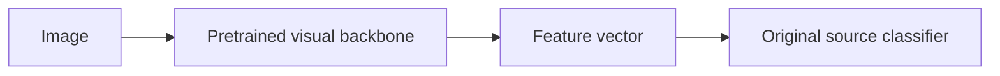
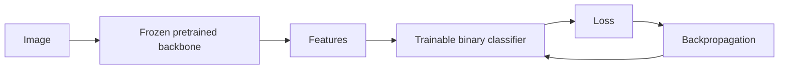

# Pretraining and freezing

## What pretraining means

A pretrained neural network is not a different kind of network. It is an architecture whose parameters already contain values learned from a previous training task.

For a convolutional layer, the transferred information is literally the learned tensors of weights and biases.

Instead of starting from random filters, the model starts from filters that already respond to useful visual patterns.

Early layers often learn relatively general visual primitives such as edges, orientation changes, contrast transitions and textures. Deeper layers combine them into more complex patterns.

This is why a model trained on a large general image dataset can still provide useful features for an industrial dataset whose labels are completely different.

## Architecture versus weights

Keep these concepts separate:

- architecture: the sequence of layers and how they are connected;
- weights: the numerical parameters inside those layers.

Two ResNet18 models can have the same architecture but very different weights:

- one can be randomly initialized;
- another can load pretrained weights.

Transfer learning primarily reuses the second component: learned parameter values.

## What is transferred to our task?

A pretrained classifier can be separated conceptually into:



The original classifier is specific to the source labels, so it is usually replaced.

For our binary task:


The backbone starts from pretrained weights. The new classifier starts from new parameters because the original source classes are irrelevant to `clean` versus `defective`.

## Feature extraction and freezing

The simplest transfer-learning strategy is to freeze the pretrained backbone.

Freezing means that its parameters remain part of the forward pass but are not updated by gradient descent.

In PyTorch the central mechanism is:

```python
for parameter in backbone.parameters():
    parameter.requires_grad = False
```

A parameter with `requires_grad=False` is treated as fixed for gradient-based optimization.

The image still passes through those layers:



Backpropagation is used to train the new classifier, but the frozen backbone weights do not receive parameter updates.

Useful mental model:

> The backbone acts as a learned feature extractor. We keep its visual representation fixed and learn only how to map those features to our target label.

## Why freeze first?

Freezing is useful when:

- the target dataset is relatively small;
- we want a fast first transfer-learning baseline;
- the pretrained representation may already be useful;
- we want to reduce the number of trainable parameters and overfitting risk.

It also creates a clean experiment. If the frozen model already beats the scratch CNN, we have evidence that pretrained features transfer to the industrial domain.

## What freezing does not mean

Freezing does not mean removing the backbone.

The backbone still executes every forward pass and still transforms the image into features.

It also does not mean that `model.eval()` and freezing are the same thing.

- `requires_grad=False` controls whether parameters are trainable by backpropagation;
- `model.train()` and `model.eval()` control the behavior of layers whose training/evaluation behavior differs.

This distinction matters for pretrained architectures that contain layers such as BatchNorm.

## Domain shift

The source images used during pretraining and our industrial images come from different distributions.

This difference is called domain shift.

A general source dataset may contain ordinary objects and natural scenes, while KSDD2 contains narrow industrial surfaces, texture variations and small defects.

Transfer learning works when enough of the learned visual representation remains useful despite that shift.

Large domain shift can reduce the value of frozen features and motivate fine-tuning.

## Preprocessing is part of the pretrained representation

A pretrained model was trained with a particular input preprocessing pipeline. When we use its pretrained weights, the expected input transform is part of the contract of those weights.

Therefore we should not blindly reuse the scratch-CNN preprocessing. When we implement the pretrained model, we will use the preprocessing associated with the selected pretrained weights and document the difference.

## Project experiment

The first M3 experiment will keep the comparison controlled:

- same KSDD2 train/validation split;
- same binary target;
- same imbalance awareness and evaluation metrics;
- pretrained backbone frozen;
- new binary classifier trainable.

Then we will compare its precision-recall behavior against the M2 scratch baseline.

## Interview explanation

A concise explanation is:

> Transfer learning reuses parameters learned on a source task as a better initialization or fixed feature extractor for a target task. In the frozen-backbone experiment, I replace the source classifier with a binary defect head and disable gradients for the backbone. This tests whether the pretrained visual representation transfers to the industrial domain before allowing the backbone itself to adapt.

## Questions to be able to answer

1. What is actually stored in pretrained weights?
2. What is the difference between an architecture and its weights?
3. Why do we replace the original classifier?
4. What does `requires_grad=False` do?
5. Does a frozen layer still participate in the forward pass?
6. Why can freezing help on a small dataset?
7. Why are freezing and `model.eval()` different concepts?
8. What is domain shift?
9. Why must preprocessing be compatible with the pretrained weights?
