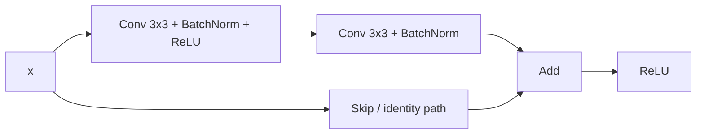
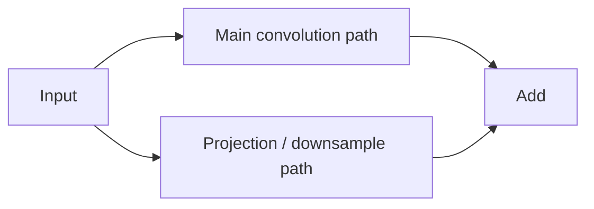

# ResNet18 and residual blocks

ResNet18 is the first pretrained backbone used in M3.

The important idea is not the name of the architecture. The important idea is the **residual connection** that lets a block learn a correction to its input instead of forcing every stack of convolutions to reconstruct the full transformation from scratch.

## Residual block

A simplified ResNet18 basic block has two paths:



If the convolutional path learns $F(x)$, the block output before the final activation is:

```math
H(x) = F(x) + x
```

The skip path therefore provides a direct route for the original representation through the block.

This helps optimization in deep networks because information and gradients do not have to pass only through every convolutional transformation in sequence.

## Why call it residual learning?

Suppose the useful transformation is $H(x)$.

Instead of directly learning $H(x)$, the convolutional path can learn the residual:

```math
F(x) = H(x) - x
```

Then:

```math
H(x) = F(x) + x
```

If keeping the input mostly unchanged is useful, the block only needs to learn a relatively small correction.

## What happens when shapes change?

The tensors being added must have compatible shapes.

When a ResNet stage changes spatial resolution or channel count, the skip path cannot remain a plain identity. A projection is used so both paths produce compatible tensors before addition.

Conceptually:



For ResNet18, stage transitions typically halve spatial resolution while increasing channels.

## ResNet18 structure for this project

We keep the project's image resize:

```text
[B, 3, 640, 224]
```

A standard ResNet18 then reduces the representation approximately as follows:

```text
input       [B,   3, 640, 224]
conv1       [B,  64, 320, 112]
maxpool     [B,  64, 160,  56]
layer1      [B,  64, 160,  56]
layer2      [B, 128,  80,  28]
layer3      [B, 256,  40,  14]
layer4      [B, 512,  20,   7]
adaptive GAP[B, 512,   1,   1]
flatten     [B, 512]
```

The original ImageNet classifier maps those 512 features to 1000 logits.

For this project we replace that classifier with:

```python
nn.Linear(512, 1)
```

so the final output is one binary-classification logit per image.

## Why is it called ResNet18?

The conventional count includes the initial convolution, the convolutional layers inside the eight basic residual blocks, and the final fully connected layer.

BatchNorm, ReLU, pooling and skip additions are not counted as separate weight layers in the name.

## An important project-specific trade-off

Our scratch CNN finished its convolutional extractor at a relatively large spatial grid. Standard ResNet18 reduces the `640 x 224` input to about `20 x 7` before global average pooling.

That aggressive downsampling could be a disadvantage for very small defects.

However, ResNet18 also brings much richer pretrained features. M3 is therefore an empirical comparison:

> Does stronger pretrained representation compensate for the greater spatial compression on KSDD2?

We should measure that rather than assume the answer.

## Preprocessing for pretrained weights

The pretrained ImageNet weights expect RGB values scaled to `[0,1]` and normalized with ImageNet channel statistics:

```text
mean = [0.485, 0.456, 0.406]
std  = [0.229, 0.224, 0.225]
```

Torchvision's default inference transform also uses a square resize/crop recipe, but this project deliberately keeps the existing `640 x 224` resize because the industrial images are elongated and a center crop could discard relevant regions.

We therefore reuse the **normalization** expected by the pretrained weights without blindly copying the square crop.

## BatchNorm and a frozen backbone

ResNet contains BatchNorm layers.

Freezing parameters with `requires_grad = False` prevents optimizer updates to those parameters, but BatchNorm also maintains running statistics controlled by training/evaluation mode.

For a genuinely fixed feature extractor in the first M3 experiment, the frozen backbone should remain in evaluation mode while the new classifier is trained.

This is why these ideas must stay separate:

```text
requires_grad=False
= do not update trainable parameters through gradients

module.eval()
= use evaluation behavior for modules such as BatchNorm
```

## Questions to be able to answer

1. What does the skip connection do in a residual block?
2. What does $F(x)$ represent?
3. Why must the two residual paths have compatible shapes?
4. What happens at a ResNet stage transition?
5. What feature vector reaches the original ResNet18 classifier?
6. Why do we replace the final classifier for this project?
7. Why are we keeping `640 x 224` instead of blindly applying a `224 x 224` center crop?
8. What is the possible disadvantage of ResNet18's spatial downsampling for small defects?
9. Why are `requires_grad=False` and `eval()` different concerns for a frozen ResNet?
