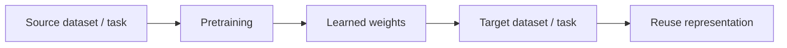
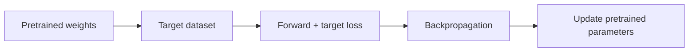
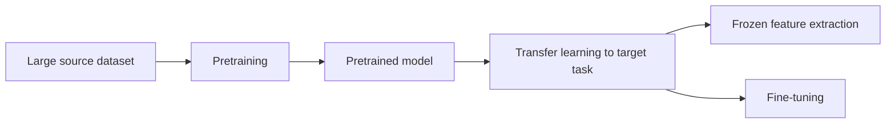

# Transfer learning versus fine-tuning

## Short answer

They are related but they are **not the same thing**.

**Transfer learning** is the broader idea:

> reuse knowledge learned on a source task/domain to help a target task/domain.

**Fine-tuning** is one specific strategy inside that broader idea:

> start from pretrained weights and continue optimizing some or all of those weights on the target dataset.

So:

```text
fine-tuning ⊂ transfer learning
```

Fine-tuning is a form of transfer learning, but transfer learning does not require fine-tuning.

---

## Transfer learning

A source model has already learned useful parameters from another dataset or task.

We reuse that representation instead of starting from random weights.



The source domain can be:

- broader than the target domain;
- different but visually related;
- the same broad domain but a different task.

It does **not** have to be strictly “another domain”.

The important idea is that knowledge is transferred from a previous learning problem.

---

## Frozen feature extraction: transfer without fine-tuning

Example:

```text
pretrained backbone
        ↓
freeze all backbone weights
        ↓
train only a new classifier
```

This is still transfer learning because the target task uses pretrained features.

But it is **not backbone fine-tuning**, because those pretrained weights never change.

Our EXP-008 is exactly this case:

```text
ImageNet-pretrained ResNet18
backbone frozen
new binary classifier trained on KSDD2
```

---

## Fine-tuning

Fine-tuning starts from pretrained weights and allows the target loss to update them.



It can be:

- **partial fine-tuning** — only selected layers/blocks are unfrozen;
- **full fine-tuning** — the complete pretrained model is trainable.

Our EXP-009 used partial fine-tuning:

```text
ResNet18
layer1-3 frozen
layer4 trainable
classifier trainable
```

Our EXP-014 uses the pretrained DeepLabV3-ResNet50 model and optimizes the complete model on KSDD2, so it is transfer learning **plus full fine-tuning**.

---

## Your mental model, refined

A good formulation is:

> Transfer learning means starting from knowledge learned in a previous source task or dataset instead of learning everything from zero.

> Fine-tuning means taking pretrained weights and continuing gradient-based training on the target dataset so that some or all of those weights adapt to the new problem.

The one correction to the simplified definition is that transfer learning does not necessarily mean “another domain”. It can also transfer between related tasks within a similar visual domain.

---

## Pretraining, transfer learning and fine-tuning

These three terms describe different stages/concepts:



### Pretraining

Creates the reusable source model.

### Transfer learning

Uses that prior knowledge on the target task.

### Fine-tuning

Updates pretrained parameters with target-task gradients.

---

## Why they often go together

A frozen pretrained representation may already work well if source and target are similar.

But if there is domain shift, frozen features may be insufficient.

Then fine-tuning lets the representation adapt:

```text
useful source features
       +
target gradients
       ↓
adapted target representation
```

This is why transfer learning and fine-tuning are often discussed together.

---

## Project evidence

### EXP-008

Transfer learning without backbone fine-tuning.

Result: frozen ResNet18 underperformed our scratch CNN because the source representation was not sufficiently aligned with industrial defects.

### EXP-009

Transfer learning + partial fine-tuning.

Result: adapting `layer4` dramatically reduced false positives at matched recall.

### EXP-014

Transfer learning + full fine-tuning of a pretrained semantic-segmentation model.

The source model is DeepLabV3-ResNet50 with pretrained segmentation weights. The target task is binary defect segmentation on KSDD2.

---

## Common mistakes

- Saying transfer learning and fine-tuning are synonyms.
- Saying any pretrained model is automatically being fine-tuned.
- Calling frozen feature extraction “fine-tuning”.
- Assuming transfer learning requires identical source and target labels.
- Assuming the source domain must always be broader than the target domain.
- Assuming fine-tuning must update the whole network.

---

## Interview explanation

> Transfer learning is the broader strategy of reusing knowledge learned on a source task. Fine-tuning is one way of doing transfer learning: I initialize from pretrained weights and continue optimizing some or all of those parameters on the target dataset. In my project, a frozen ResNet18 experiment was transfer learning without backbone fine-tuning, partial ResNet18 training was transfer learning with partial fine-tuning, and DeepLabV3-ResNet50 is being fully fine-tuned for binary industrial-defect segmentation.

## Questions to be able to answer

1. Can you do transfer learning without fine-tuning?
2. Can fine-tuning be partial?
3. What is the difference between pretraining and fine-tuning?
4. Why might frozen features fail under domain shift?
5. Which experiments in this project demonstrate each regime?
